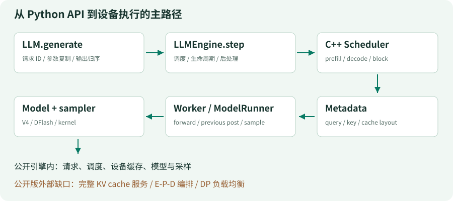

# Learn-DeepInfer

### 从一条请求，搭出一台小型推理引擎

**[在线阅读完整教程 →](https://xinzhuwang-wxz.github.io/Learn-DeepInfer/)** · [从第一课开始](https://xinzhuwang-wxz.github.io/Learn-DeepInfer/01-loop.html) · [Markdown 讲义](docs/00-start.md) · [运行代码](lessons/01_request_loop/code.py)

在线教程可以直接打开阅读，不需要 GPU、模型、API key 或自行部署。想修改和运行实验时，再使用下方快速开始。


从一条请求，到可验证的推理系统。

中文优先的渐进式实践：用 Python 标准库搭建 MiniInfer，在同一批请求上逐步加入预算、内存所有权、阶段投票、推测验证预算、异步提交、可见域与语法状态。每课保留可独立运行的完整快照、相邻代码差异、故障实验和固定版本的上游源码证据。

这不是 DeepInfer 的 CPU 移植。教学代码不加载模型，不访问网络，也不构建 GPU 扩展。

## 你会搭出什么

一台可以观察每次状态变化的 **MiniInfer**：请求进入队列，预算决定谁继续，内存块记录归属，异步结果等待提交，语法状态与输出一起回退。你会追问每一步“谁拥有资源、什么已经发生、何时才可以释放”，而不只记住推理系统名词。

[](https://xinzhuwang-wxz.github.io/Learn-DeepInfer/)

### 从机制到可验证的行为

- **九个可运行阶段**：从最小请求循环逐步搭建，每个阶段有完整快照与相邻差异。
- **图、代码、解释在一起**：沿同一批请求看清预算、块归属、在途结果与最终交付。
- **故障可以亲手重现**：越界预算、过早释放、错误回退都对应可观察的失败。
- **从状态到计算**：CPU 参考实验把 attention 张量、缓存布局和专家路由接到具体数值上。
- **从教学到真实源码**：关键机制对应固定版本的上游证据，教学简化与硬件边界分开说明。

## 怎么学

适合会读基本 Python、想理解推理系统内部机制的读者。先读 00，再按 01 → 09 运行主线；08+ 的计算实验可在理解异步与内存之后阅读。每课按“问题 → 机制图 → 关键代码 → 状态走读 → 故障练习”展开。

## 三分钟开始

```bash
python lessons/01_request_loop/code.py
python lessons/09_metrics/code.py
python -m unittest discover -s tests -v
```

代码只需要 Python 3.10+ 标准库。讲义可直接在本仓库阅读；构建网页版另需已安装的 [Pandoc](https://pandoc.org/installing.html)。

| 单元 | 你将增加或检查什么 |
|---|---|
| [00 · 先造一台小引擎](docs/00-start.md) | 学习边界、同一批请求与源码版本 |
| [01 · 请求的生命线](docs/01-loop.md) | 请求身份、结束条件与交付顺序 |
| [02 · 给长请求一个预算](docs/02-prefill.md) | 分块 prefill 与单调进度 |
| [03 · 内存不是计数器](docs/03-memory.md) | block 所有权、背压、失败清理 |
| [04 · 选同一种下一步](docs/04-parallel.md) | 阶段协商与两轮投票 |
| [05 · 验证更多，不一定更快](docs/05-speculation.md) | 收益、成本与离散预算 |
| [06 · 算出来了，为什么还不能结束？](docs/06-async.md) | 延迟提交、flush 与资源生命周期 |
| [07 · 有界重放与可见域](docs/07-replay.md) | 删除计算前先证明依赖 |
| [08 · token 与语法一起回退](docs/08-grammar.md) | 允许集合、回滚与确定性条件 |
| [08+ · 计算路径的三张账本](docs/08-compute.md) | attention 张量、缓存地址、专家路由与精度 |
| [09 · 先数对，再说快](docs/09-evidence.md) | 集成验收与实际运行轨迹 |
| [10 · 走向真实验证](docs/10-reproduce.md) | 硬件、依赖、副作用与验证等级 |
| [11 · 读懂一个状态迁移](docs/11-method.md) | 调用链、所有权与可反驳结论 |
| [12 · 完整代码册](docs/12-code.md) | 九个完整快照与真实阶段差异 |
| [13 · 版本、许可与来源](docs/13-sources.md) | 精确源码锚点与证据边界 |

`lessons/` 是累计实现主线；`examples/` 是单机制探针。网页版还提供离线搜索、学习进度与事件取证台，轨迹由真实运行教学代码生成，而不是手工动画。

## 维护与本地预览

直接学习请使用顶部在线入口。下面只针对修改课程、重建网站或自行托管。

<details>
<summary>展开构建、Pages 发布与可选 PDF 说明</summary>

### 本地构建与检查

```bash
make check
# 打开 site/index.html；也可在项目根目录运行：
python -m http.server 8000 --directory site
```

`make check` 从 Markdown 和 Python 源文件生成静态站，运行教学测试、源码哈希与站内锚点检查，并检查根路径和 `/Learn-DeepInfer/` 项目子路径。网页只使用相对链接和本地资源，没有 CDN、外部字体或构建时 API 密钥。

- 正文与课程清单：[docs/](docs/)、[book.json](book.json)。
- 普通构建只读取已提交的 Markdown、代码与图，不覆盖练习修改。正文代码片段失配时检查会报错。
- `make regenerate-lessons` 明确重写全部快照；`make regenerate-evidence` 明确重写差异、轨迹、09课静态表与12课代码册；`make regenerate-diagrams` 明确重写生成图。运行前先保存自己的修改，这些命令不属于默认构建或 CI。
- 完整阅读入口：生成后的 `site/book.html`。
- 每章网页可下载 Markdown；代码课可下载 `code.py` 与 `delta.patch`。
- `site/`、`output/`、`reports/` 是生成目录，不提交到 Git。
- `make package` 产生 `output/Learn-DeepInfer-source.zip`（可重建源码与许可）和 `output/Learn-DeepInfer-offline.zip`（解压后打开 `index.html`，含网站、Markdown及源码包）。均不包含旧PDF、研究checkout或缓存。

### GitHub Pages 自动发布

工作流位于 [.github/workflows/pages.yml](.github/workflows/pages.yml)。所有 GitHub Actions 固定到官方仓库的完整 commit；版本与来源见 [.github/actions-lock.json](.github/actions-lock.json)。

1. 将本目录作为独立仓库推送到 GitHub，默认分支为 `main`。
2. 在仓库 Settings → Pages → Build and deployment 中选择 **GitHub Actions**。
3. 推送 `main` 后，工作流运行 `make check`，再上传并部署 `site/`；也可手动触发。
4. Pull Request 只构建和检查，不部署。部署 job 只授予 `pages: write` 与 `id-token: write`，不用个人访问令牌或额外 secrets。
5. 仓库使用项目页面时不必硬编码仓库名；资源、章节、搜索结果和下载均相对当前页面解析。最终地址以 GitHub 部署输出为准。

CI 使用 GitHub 的 Ubuntu 24.04 runner、Python 3.12 和 Ubuntu 官方软件源中的 Pandoc。无需 GPU、模型、Node 前端构建或付费服务。Pandoc 版本会记录在验证报告；不同版本可能产生格式差异，不能将本地字节一致性结论推广到所有构建环境。若 Pages 权限或组织策略阻止部署，应修正仓库设置，不把检查通过当作已上线。

### 可选：本地导出 PDF

PDF 不进入默认构建、CI、源码包或网站下载。需要一份临时阅读副本时，在已具备 Playwright、可启用沙箱的 Chromium、CJK 字体和 pypdf 的环境执行 `make pdf`。可用 `LEARN_PLAYWRIGHT_MODULE`、`LEARN_CHROMIUM` 指向现有安装。脚本不会自动下载浏览器，也不允许关闭浏览器沙箱。

结果只保存在 `output/pdf/Learn-DeepInfer.pdf`。修改 Markdown 后应重新导出并检查，不把旧 PDF 当作当前课程。没有这些可选依赖也能完成全部教学测试与网页构建。

</details>

## 来源、许可与验证边界

上游：[deepseek-ai/DeepInfer](https://github.com/deepseek-ai/DeepInfer)，固定提交 `9bd9cf243fc53ef9afbf8f04d391d989117d6ab9`，Apache-2.0。[sources.json](sources.json) 记录文件哈希、行号和永久链接；[upstream.lock.json](upstream.lock.json) 记录核验条件。

[reference/DeepInfer/](reference/DeepInfer/) 只保留实际引用的、未修改的 Apache 源文件及原版权声明，供离线阅读和哈希校验，它不是可运行 checkout。未初始化或分发 vendor 子模块。讲解、图、教学代码和发布脚本采用 [MIT](LICENSE)，上游许可见 [NOTICE.md](NOTICE.md) 和 [Apache-2.0 原文](licenses/DeepInfer-Apache-2.0.txt)。

本教程非官方。DeepInfer 的目标设备为 NVIDIA SM100 / Ascend 950，不代表普通笔记本可以运行。未执行上游构建、真实推理、GPU kernel、分布式正确性、PPL 或吞吐测试。教学测试及其子案例仅验证 CPU 模拟器和数学参考的不变量。
