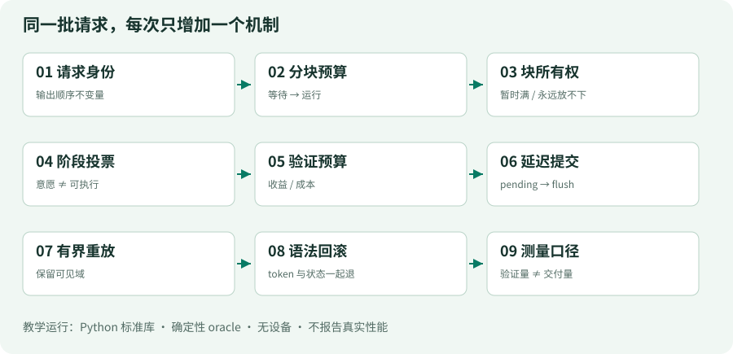

# 00 · 先造一台小引擎，再读大系统

> 你将亲手搭建 MiniInfer：一个没有模型、没有 GPU、只用 Python 标准库的推理运行时模拟器。每一课都能独立运行；下一课在同一条请求生命周期上增加一个机制。它不是 DeepInfer 的 CPU 移植，也不产生有意义的自然语言推理结果。

## 完成后，你应能回答什么

- 一个请求为什么要从 waiting 进入 running，而不是直接调用一次 forward？
- 为什么空闲内存、未完成请求、设备在途工作是三件不同的事？
- 多卡中的“大家选同一种 step”为什么比单卡 FIFO 多一次投票？
- 多验证几个草稿 token 什么时候反而变慢？
- 为什么有的结果要到下一轮或 flush 才可见，返回对象又为什么可能必须复制？
- 为什么公开仓库中有 KV block 管理，却不能说生产 KV 缓存服务已经开源？

课程的主角始终是同一批请求 A、B、C。我们先让它们按顺序返回 `true / false / true`，然后不断增加约束。答案由显式 fake oracle 提供，因此你可以把注意力放在调度、状态和不变量上，而不是下载权重。

## 课程地图



| 步骤 | 只增加一个核心机制 | 上一版暴露的问题 |
|---|---|---|
| 01 | 请求身份、终止和输出顺序 | 谁先完成不等于输入顺序 |
| 02 | 分块 prefill 的 token 预算 | 长请求独占一步 |
| 03 | block 所有权与资源回收 | 放不下、暂时满、释放早了被混为一谈 |
| 04 | DP step 类型协商 | 某个 rank 自作主张进入另一种 collective |
| 05 | 草稿验证预算 | 验证越多不一定吞吐越高 |
| 06 | 延迟提交和 drain | CPU 的“结束”早于设备的“完成” |
| 07 | 有界 replay 元数据 | 复用状态时到底必须重算哪一段 |
| 08 | 语法状态及回滚 | 丢弃 token 后，约束状态仍前进 |
| 09 | 计数口径与集成验收 | 优化了假指标，却没有增加实际输出 |

源码导读不是正文的替代品。每课按“问题 → 最小变化 → 运行观察 → 故障实验 → 上游对照 → 何时失效”组织。附录解释教学抽取方法、来源与许可。

## 十分钟开始

在项目根目录执行：

```bash
python lessons/01_request_loop/code.py
python lessons/02_chunk_budget/code.py
python lessons/09_metrics/code.py
python -m unittest discover -s tests -v
```

只需要 Python 3.10 或更新版本。教学代码不 import torch、deepinfer、transformers，不联网，不编译扩展，不调用 API，也不会下载模型。上游 DeepInfer 的运行要求与这些教学例子完全不同。

在第 08 课之后还有计算路径附加实验，解释张量、KV 格式与专家路由，不强行把它伪装成完整 V4 模型。

每个 `lessons/NN_name/code.py` 是独立快照，不需要安装本项目。它们的全部源代码也在课程末尾的代码册中，可直接阅读、复制与比较。`examples/` 中较短的文件是单一机制探针，用于观察边界，不是另一个主教程。

## 三种阅读速度

- 快速导览：00、01、06、09，约 60–90 分钟；只建立运行时轮廓，不代表掌握 DeepInfer。
- 实践路线：逐课运行、读差异、完成故障实验，约 6–10 小时，取决于 Python/C++ 与推理基础。
- 源码路线：沿固定版本链接读完整函数及测试；分布式、内存与数值一致性需要另外安排数天。这里不把阅读时间伪装成能力保证。

建议预备知识：Python 数据结构、函数与类；知道 token、prefill、decode 的含义即可开始。阅读 C++ 章节时，需要理解引用生命周期、共享所有权、异步设备执行与 collective 的基本约束。

## 版本是一份实验条件

本教程固定 DeepInfer 提交 `9bd9cf243fc53ef9afbf8f04d391d989117d6ab9`，提交日期为 2026-10-21；资料核验于 2026-10-25。版本号字段为 `0.1.0`，不意味着任意同名包都等价于这里的源码。

我们使用三类标记：

- **上游事实**：从固定提交的实现、测试或文档直接读取。
- **教学模型**：为了隔离机制而故意改写的可运行代码。
- **推断 / 延伸**：从实现推导出的工程含义，需要新的实验验证。

每个来源链接都含提交 SHA 和行范围。`sources.json` 还记录文件 SHA-256；`python scripts/verify.py` 检查本地源码是否与证据一致，而不是声称 CPU 例子验证了 GPU kernel。

## 先承认边界

官方 README 将这一版描述为离线推理核心，支持 DeepSeek-V4.1-Flash；支持的加速器是 NVIDIA SM100 和华为 Ascend 950。软件前提包括 Linux、GCC ≥ 13、Python 3.12、NVIDIA 的 CUDA 13 或 Ascend 的 CANN 9.2。不要由此推导“所有 CUDA 卡都能运行”。

完整服务还需要公开版未包含的 KV cache system、VE/Prefill/Decode 分离部署编排以及 DP 副本负载均衡。仓库里的 block manager、状态缓存和扩展钩子，并不等于这些外部系统已经完整交付。[源码 · 发布范围、硬件与复现入口](https://github.com/deepseek-ai/DeepInfer/blob/9bd9cf243fc53ef9afbf8f04d391d989117d6ab9/README.md#L1-L96) [源码 · PD 与外部缓存扩展钩子](https://github.com/deepseek-ai/DeepInfer/blob/9bd9cf243fc53ef9afbf8f04d391d989117d6ab9/deepinfer/engine/llm_engine.py#L800-L829)

官方性能图的 prefill 使用 4 张 SM100，decode 使用 64 张，均位于各自的 scale-up domain。它们不是本教程跑出的数字，也不是个人电脑的最低硬件要求。Q&A 中的“大规模高效部署”建议更不能当成所有实验的硬性最小卡数。[源码 · 生产系统背景，不等于发布内容](https://github.com/deepseek-ai/DeepInfer/blob/9bd9cf243fc53ef9afbf8f04d391d989117d6ab9/doc/inference_deployment_qa.md#L1-L130)

## 第一次运行，不只看“成功”

第01课的入口把三个请求交给同一个引擎：

```python
requests = [Request('A', 7, 'true'),
            Request('B', 3, 'false'),
            Request('C', 5, 'true')]
```

这是输入说明，类定义和可运行入口保存在每课的完整快照里。第二列是prompt长度，第三列是预设答案；并非把字符串当模型预测。先运行`python examples/observe_lesson.py 1`，再运行`python examples/observe_lesson.py 2`：输出相同，computed与ticks不同。

第一份观察记录里，computed始终是0，因为该课还未建模prefill；第二份在前4个tick依次到达`4/0/0`、`7/1/0`、`7/3/2`、`7/3/5`。**相同最终字符串不能证明相同工作量，也不能证明两种引擎等价。**

### 自检与答案

1. A和C先完成，返回顺序是否应改成A/C/B？答：不改，按入口A/B/C交付。
2. 第二课多4个tick能否称为真实延迟增加？答：不能；tick不是秒，且第一课省略了输入计算。
3. 本地CPU测试全过，能否确认SM100上的attention正确？答：不能；这需要相应设备、权重、数值参考和运行记录。
