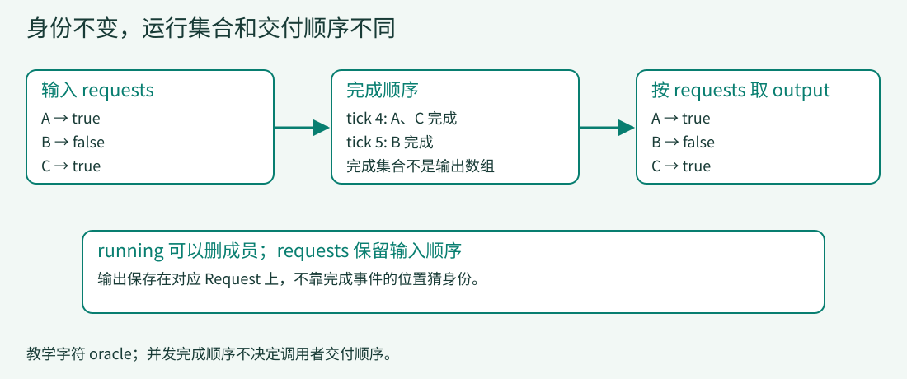

# 01 · 一条请求的生命线

> 先造一台会把结果交对人的小引擎。A、B、C一起前进，不同时间结束；调用者仍按输入顺序取回结果。

## 先观察一个“每个字符串都对”的错误

三条请求的输入顺序是A、B、C，教学答案依次为`true`、`false`、`true`。每次循环让每条活跃请求生成一个字符。第4步A和C结束，第5步B结束。如果按完成顺序收集返回值，得到的是`true / true / false`，内容单独看都合法，B、C却被调换了。

本课保留三个概念，不把它们合并成一个列表：

- **身份**：一个输出属于哪个request。
- **运行集合**：下一步还有谁需要推进。
- **交付顺序**：调用者按哪个顺序索取结果。



[放大查看身份与交付图](../assets/loop-identity.svg)

在仓库根目录运行完整快照与方法边界观察器：

```bash
python lessons/01_request_loop/code.py
python examples/observe_lesson.py 1
```

最终输出应为`['true', 'false', 'true']`，逻辑循环数为5，提交字符数为13。这个模拟器没有模型、tokenizer或设备执行；`answer`是预先写好的oracle答案，不是偷偷加载的语言模型。

## 1. 一个请求对象，保留自己的输出

来源：[Request，9–14行](../lessons/01_request_loop/code.py#L9-L14)。

<!-- code: lessons/01_request_loop/code.py:L9-L14 -->
```python
@dataclass
class Request:
    request_id: str
    prompt_length: int
    answer: str
    output: str = ''
```

`request_id`用于识别，`output`存这条请求已提交的字符。`prompt_length`本课只是为后续保留的输入信息，还不参与计算。因此A的prompt长7并不会比C的prompt长5更晚开始生成；下一课才让这份工作量影响调度。

每个Request的`output`独立，不能用一个全局字符串再按猜测的长度拆回去。同样，入口必须拒绝重复ID，否则两条请求会在`finished`集合中挤成一条。来源：[初始化，18–27行](../lessons/01_request_loop/code.py#L18-L27)。

<!-- code: lessons/01_request_loop/code.py:L18-L27 -->
```python
if any(r.prompt_length<1 or not r.answer for r in requests):
    raise ValueError('positive prompt length and nonempty oracle answer required')
if len({r.request_id for r in requests}) != len(requests):
    raise ValueError('duplicate request ID')
self.requests = requests
self.trace = []
self.ticks = 0
self.finished = set()
self.waiting = []
self.running = list(requests)
```

`self.requests`保存原输入顺序。`self.running`是它的列表副本，保存相同请求对象，但后续允许移除已经结束的成员。删掉running里的A，不会把A从最终交付列表中删掉。

本课还要求prompt长度为正、oracle答案非空。真实系统如何处理空prompt、EOS等属于不同接口契约，不由这个小例子决定。

## 2. 生成一步：位置来自本请求，不来自全局计数

来源：[decode，35–42行](../lessons/01_request_loop/code.py#L35-L42)。

<!-- code: lessons/01_request_loop/code.py:L35-L42 -->
```python
def decode(self):
    active = list(self.running)
    offsets = {r.request_id:len(r.output) for r in active}
    lengths = [1]*len(active)
    for request,count in zip(active,lengths):
        start = offsets[request.request_id]
        text = request.answer[start:start+count]  # fake oracle, NOT a model
        self.emit(request,text)
```

这一段依次做四件事：

1. 复制当轮活动集合，避免提交时删除running成员影响本轮遍历。
2. 对每个ID记录它已提交的长度，作为下一段起点。
3. 本课每条请求只分到一个字符的位置。
4. 从oracle取这一段，再把请求对象和字符一起传给`emit()`。

第4步开始时A和C的输出均为`tru`，起点3取到`e`；B输出`fal`，起点3取到`s`。位置都是3，但字符和所有者不同，不能只保留一个无主的字符batch。

这是控制流替身，不是生成算法：真实forward会得到数值张量，sampler根据分布与停止条件产生token；这里切片只是让完成时序可预测。

## 3. 提交一步：结束与交付是两回事

来源：[emit，29–34行](../lessons/01_request_loop/code.py#L29-L34)。

<!-- code: lessons/01_request_loop/code.py:L29-L34 -->
```python
def emit(self, request, text):
    request.output += text
    self.trace.append(('emit', request.request_id, text))
    if len(request.output) == len(request.answer):
        self.finished.add(request.request_id)
        self.running = [r for r in self.running if r is not request]
```

先追加字符，再判断是否到达教学答案长度。达到长度才进入finished，并从running移除。第4步处理A后，仍要处理已经保存在active里的B、C；这就是上一段为什么先复制活动集合。

**移出运行集合不等于立刻决定返回值位置。** 最外层始终从原requests组装返回值。来源：[run，44–50行](../lessons/01_request_loop/code.py#L44-L50)。

<!-- code: lessons/01_request_loop/code.py:L44-L50 -->
```python
def run(self):
    while len(self.finished) < len(self.requests):
        self.ticks += 1
        if self.ticks > 1000:
            raise RuntimeError('teaching liveness guard: inspect trace')
        self.decode()
    return [r.output for r in self.requests]
```

1000次上限只是让教学死循环显式暴露，不是生产超时策略。输入为空时，`0 < 0`为假，不做任何decode就返回空列表。

## 4. 沿同一A/B/C逐步走一遍

下表是`observe_lesson.py 1`在完整decode方法返回后的状态，∅表示空字符串。

| tick | A.output | B.output | C.output | 下一步running | finished |
|---:|---|---|---|---|---|
| 0 | ∅ | ∅ | ∅ | A、B、C | 空 |
| 1 | t | f | t | A、B、C | 空 |
| 2 | tr | fa | tr | A、B、C | 空 |
| 3 | tru | fal | tru | A、B、C | 空 |
| 4 | true | fals | true | B | A、C |
| 5 | true | false | true | 空 | A、B、C |

从trace的`emit`事件读出完成先后是A、C、B，从返回值读出交付顺序是A、B、C。只验证最后有13个字符还不够，它抓不住B/C错位。

## 5. 真实入口如何保住这个契约？

DeepInfer入口的`_add_request()`先复制SamplingParams，再分配递增字符串ID；随后tokenize并调用`LLMEngine.add_request()`。复制的是每请求参数，不是本课后面要讲的输出对象。[请求入队](https://github.com/deepseek-ai/DeepInfer/blob/9bd9cf243fc53ef9afbf8f04d391d989117d6ab9/deepinfer/entrypoints/llm.py#L144-L166)

运行期间，它按`output.request_id`分桶。运行结束后，下面这几行把结果按数字ID重新排列。来源：[llm.py，187–190行](https://github.com/deepseek-ai/DeepInfer/blob/9bd9cf243fc53ef9afbf8f04d391d989117d6ab9/deepinfer/entrypoints/llm.py#L187-L190)。

<!-- code: reference/DeepInfer/deepinfer/entrypoints/llm.py:L187-L190 -->
```python
request_ids = sorted(outputs, key=int)
results: list[list[RequestOutput] | str] = [outputs[i] for i in request_ids]
if self.decode_sequence:
    results = [self.llm_engine.tokenizer.decode([x.token_id for x in output]) for output in results]
```

注意`key=int`：ID是数字字符串，不能按字符串字典序把`10`放在`2`之前。这不是说任何外部业务ID都该转成整数，而是这个离线入口自己生成数字ID的局部约定。

`decode_sequence`也改变返回形式：为真时将记录中的token ID解码成字符串；否则保留记录列表。不能只读函数名就断言接口永远返回文本。输出池clone与最终flush在[第06课](06-async.md)展开，本课不把真实引擎折叠成字符串切片来证明它们。

## 6. 故障与练习：先查身份，再查内容

**故障一：按答案长度排序返回。** 在代码副本中把末行改为按`len(r.answer)`排序。A/C的长度4排在B的长度5前，返回变成`['true','true','false']`。没有异常，但与原输入不再一一对应。

**故障二：允许重复ID。** 删除入口的重复ID检查，创建两条ID都为A的请求。两条完成只给集合增加一个元素，主循环不能用集合大小证明全部完成，最终触发活性保护。上限能暴露症状，不能修复身份契约。

练习与可观察目标：

1. 把输入改为B、A、C。断言返回`['false','true','true']`；不能只断言排序后相等。
2. 对空输入断言结果为`[]`、ticks为0、trace为空。
3. 从trace找出每条请求最后一次emit，证明A/C发生在B之前，而返回顺序没有变化。
4. 在纸上设计取消：如果已取消请求仍在active副本中，下一次emit应当怎么处理？本课没有取消实现，先写“取消后不再提交”的测试条件，不把一个集合删除动作当作完整取消协议。

### 参考答案要点

输入换成B/A/C后，requests保留此顺序，最终false/true/true；完成事件仍按实际生成长度发生。空输入不进入while，所以ticks=0。查最终emit可见A、C为tick4，B为tick5；不能用集合相等替代顺序检查。取消设计需要在emit前检查请求是否仍允许提交，并明确迟到结果的丢弃与资源归还；当前代码没有这一协议。

[完整代码](../lessons/01_request_loop/code.py) · [本课新增代码](../lessons/01_request_loop/delta.patch)。下一课不改变身份和交付契约，只让prompt工作量真正进入时间线。

