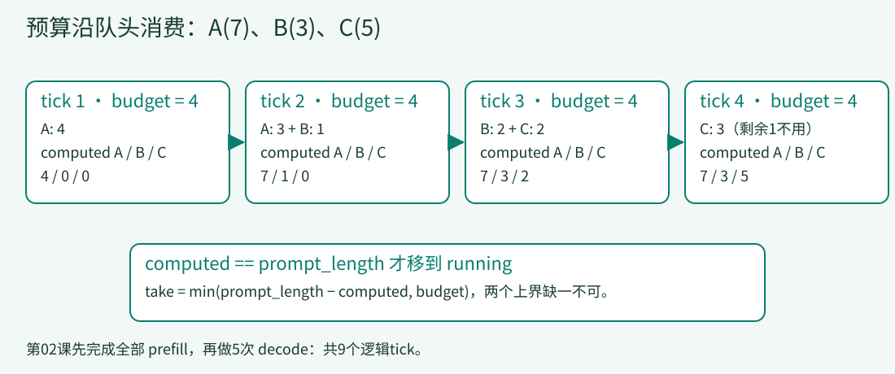

# 02 · 给长请求一个预算

> 上一课的prompt长度没有任何作用。本课把输入处理加入同一引擎：waiting保存未完成上下文，computed记录进度，每轮prefill只消耗有限预算。

## 为什么不能把“开始生成”当成免费动作？

A/B/C的prompt长度分别是7、3、5。第01课把它们直接放入running，像是15个输入位置都已经处理完。真实模型要先处理上下文，才能生成后续内容。一个调度器必须知道还有多少输入工作，不能只会数输出。

本课设每次prefill最多处理4个位置。它解决的是**单轮工作量有上界**，不是自动保证短请求公平，也不保证端到端延迟下降。仍按FIFO处理，长A在队头时B需要等待；本课还采用严格prefill优先，A就绪后也可能等其他prompt。



[放大查看分块预算图](../assets/prefill-budget.svg)

```bash
python lessons/02_chunk_budget/code.py
python examples/observe_lesson.py 2
```

应得到与上一课相同的`true / false / true`，但逻辑tick从5变成9：4次prefill加5次decode。这是加入此前忽略的工作，不是测出某个实现“慢了80%”。

## 1. 将“收到请求”与“可以生成”分开

来源：[Request，9–15行](../lessons/02_chunk_budget/code.py#L9-L15)。

<!-- code: lessons/02_chunk_budget/code.py:L9-L15 -->
```python
@dataclass
class Request:
    request_id: str
    prompt_length: int
    answer: str
    computed: int = 0
    output: str = ''
```

`computed`是已处理的prompt位置数，不是已生成字符数；`output`仍归生成结果所有。这两根进度条不能互相代替。

初始化现在把请求放入waiting，running为空。来源：[初始化，23–28行](../lessons/02_chunk_budget/code.py#L23-L28)。

<!-- code: lessons/02_chunk_budget/code.py:L23-L28 -->
```python
self.requests = requests
self.trace = []
self.ticks = 0
self.finished = set()
self.waiting = list(requests)
self.running = []
```

不变量是`0 <= computed <= prompt_length`。只有等号成立后，请求才有资格加入running。原始requests列表仍不动，所以返回顺序契约没有改变。

## 2. 每一个chunk都从剩余量中扣

来源：[prefill，37–46行](../lessons/02_chunk_budget/code.py#L37-L46)。

<!-- code: lessons/02_chunk_budget/code.py:L37-L46 -->
```python
def prefill(self):
    budget = 4
    while self.waiting and budget:
        request = self.waiting[0]
        take = min(request.prompt_length-request.computed, budget)
        request.computed += take
        budget -= take
        self.trace.append(('prefill', request.request_id, take))
        if request.computed == request.prompt_length:
            self.running.append(self.waiting.pop(0))
```

按第2次prefill代入数字：

1. 预算重置为4，A已处理4/7，剩余3，所以`take=min(3,4)=3`。
2. A.computed从4变成7，预算从4变成1。记录的是本次新增3，不是累计7。
3. A满足等号，从waiting移到running。
4. while仍有1预算，队头变成B。B剩余3，本次取1，B.computed变成1。

`take`同时受两个上界限制：不能超过当前请求的剩余量，也不能超过这一轮全局剩余预算。只写其中一个都会错。

如果写成`min(request.prompt_length, budget)`，A第二轮还会取4，computed变成8，越过7。结束判断恰好用等号，A将永远不能出队。这个反例不是“等号应该改成大于等于”那么简单：真正的问题是重复计入已经处理过的输入。

## 3. 一轮只选一个阶段

来源：[run，57–66行](../lessons/02_chunk_budget/code.py#L57-L66)。

<!-- code: lessons/02_chunk_budget/code.py:L57-L66 -->
```python
def run(self):
    while len(self.finished) < len(self.requests):
        self.ticks += 1
        if self.ticks > 1000:
            raise RuntimeError('teaching liveness guard: inspect trace')
        if self.waiting:
            self.prefill()
        else:
            self.decode()
    return [r.output for r in self.requests]
```

只要waiting非空，这轮就做prefill；只有waiting空了才decode。这是为隔离一个机制而采用的简单策略，并不是DeepInfer所有引擎模式的调度算法。第04课才加入跨参与者的阶段协商。

也不要混淆“请求移入running”与“这轮已经生成首字符”：教学prefill只推进computed，不采样。上游prefill可以伴随首token采样，这个差异会影响首输出时间线。

## 4. 同一A/B/C的完整输入账

方法结束快照：

| tick | 本次prefill新增 | computed A/B/C | waiting | running | 输出 A/B/C |
|---:|---|---|---|---|---|
| 1 | A:+4 | 4 / 0 / 0 | A、B、C | 空 | ∅ / ∅ / ∅ |
| 2 | A:+3，B:+1 | 7 / 1 / 0 | B、C | A | ∅ / ∅ / ∅ |
| 3 | B:+2，C:+2 | 7 / 3 / 2 | C | A、B | ∅ / ∅ / ∅ |
| 4 | C:+3 | 7 / 3 / 5 | 空 | A、B、C | ∅ / ∅ / ∅ |
| 5 | 无，decode | 7 / 3 / 5 | 空 | A、B、C | t / f / t |
| 8 | 无，decode | 7 / 3 / 5 | 空 | B | true / fals / true |
| 9 | 无，decode | 7 / 3 / 5 | 空 | 空 | true / false / true |

前4轮的输入增量分别为4、4、4、3，总计15，恰好等于7+3+5。A在tick2已经就绪，却等到tick5才生成。看到这个延迟，应该先问策略是否有意如此，而不是把它当作预算公式有错。

## 5. 真实scheduler为什么不只有一个min？

DeepInfer `_schedule_prefill()`先检查终止/可调度状态、prompt限制、块与state容量，再考虑最大prompt数及上下文长度总和。剩余prompt量来自`get_len() - cache.num_tokens`，不是从0重新处理整个输入。[准入与剩余工作](https://github.com/deepseek-ai/DeepInfer/blob/9bd9cf243fc53ef9afbf8f04d391d989117d6ab9/csrc/engine/scheduler.hpp#L351-L460)

其中预算裁剪还有CP对齐。来源：[scheduler.hpp，467–475行](https://github.com/deepseek-ai/DeepInfer/blob/9bd9cf243fc53ef9afbf8f04d391d989117d6ab9/csrc/engine/scheduler.hpp#L467-L475)。

<!-- code: reference/DeepInfer/csrc/engine/scheduler.hpp:L467-L475 -->
```cpp
// 满足下面的条件才会对 prompt 做截断 (截断到基础长度)：
// 加上当前这个 prompt 后会超过基础长度
/// @note 算剩余token时要考虑到cp的pad
if (seq_workload > (max_num_batched_tokens - num_batched_tokens) / cp_align * cp_align) {
    new_workload = std::min(seq_workload, (max_num_batched_tokens - num_batched_tokens) / cp_align * cp_align);
    seqlen_q = new_workload;
    TORCH_CHECK(
        seqlen_q < seq_workload, "_schedule: is_chunked must be true:, seqlen_q:", seqlen_q, " seq_workload: ", seq_workload);
}
```

这段按`cp_align`向下取整剩余预算，防止表面上还放得下、补齐后却超预算。随后还要调整checkpoint与多模态边界，检查chunked-prefill开关和lookahead最低要求；教学版没有这些形状约束。[后续裁剪](https://github.com/deepseek-ai/DeepInfer/blob/9bd9cf243fc53ef9afbf8f04d391d989117d6ab9/csrc/engine/scheduler.hpp#L477-L511)

通过所有检查后，源码才集中提交有副作用的状态：累计对齐后的batch tokens、分配块、设置RUNNING、记录本轮seqlens。未完成chunk还会记录剩余长度。这个“先判断，再提交”的边界很重要，否则一次未被接受的计划也可能偷偷消耗资源。[提交调度结果](https://github.com/deepseek-ai/DeepInfer/blob/9bd9cf243fc53ef9afbf8f04d391d989117d6ab9/csrc/engine/scheduler.hpp#L513-L545)

本课直接在prefill中修改computed，省略了“调度计划发出→设备完成→缓存进度确认”的多阶段生命周期。因此它能检验预算算术与队列迁移，不能证明真实GPU缓存已准备好。

## 6. 故障与练习：把每轮的账对上

| 错误改动 | 首个可观察信号 | 应保留的断言 |
|---|---|---|
| take使用完整prompt_length | A第二轮computed达到8 | computed不能越过prompt_length |
| 忘记扣减budget | 一轮可能累计处理超过4 | 同tick的prefill增量和不大于4 |
| chunk后立即移入running | A只处理4/7就开始生成 | 首次emit前computed必须完整 |
| 每轮computed重置为0 | A重复处理同一个chunk | 每请求computed单调，最终增量恰为prompt长度 |

练习：

1. 将预算改为3，先手算每轮分配，再运行副本。断言总输入增量仍为15，最终内容与顺序不变。
2. 预算为1时记录A进入running和第一次emit的tick。说明为什么“更小的chunk”没有自动带来更早的首输出。
3. 加一个局部`progress_this_step`计数，让每次prefill返回实际处理数。后续容量不足时，如果它为0而running非空，下一步应该做什么？第03课会把这个问题变成一个可运行的背压反例。

### 参考答案：改变预算而不改变语义

预算3时，五轮分配依次为`A3`、`A3`、`A1+B2`、`B1+C2`、`C3`；总计15，随后5轮decode，总tick为10。预算1时，A在tick7进入running，但waiting到tick15才清空，第一次emit在tick16。因此小chunk只限制单步工作，不自动改变prefill优先策略。若prefill进度为0而running非空，应转decode让已有请求完成并释放容量；两者都不能前进时，要区分永久不可能与外部等待，而不是无限空转。

[完整代码](../lessons/02_chunk_budget/code.py) · [相邻差异](../lessons/02_chunk_budget/delta.patch)。本课守住输入预算；下一课让资源不足真正阻止准入，并要求引擎仍能前进。

