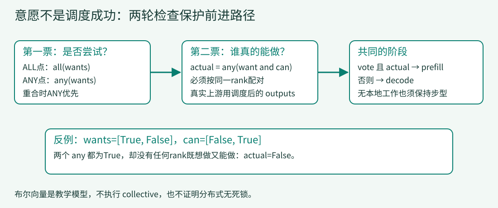

# 04 · 多个rank必须选同一种下一步

> 一台引擎可以自己决定prefill或decode；参与同一执行组的多个rank不能各走各的。本课用布尔向量模拟协商，重点是意愿、实际可执行性和一致的阶段，不启动多进程或collective。

## 上一课的“有waiting就尝试”还少了谁？

第03课解决了本地资源不足：C等不到块时，先推进A/B。现在设rank0有A/B/C，rank1暂时空闲。若rank0进入prefill、rank1进入decode，后续模型与通信可能采用不一致的形状或调用顺序。

不能让每个rank独立执行同一段`if waiting`就假装完成了分布式调度。即使大家先同意做prefill，也可能全部分配失败，得到一个没有实际工作的决定。因此要回答两个不同问题：

1. 这一轮，大家是否同意尝试prefill？
2. 尝试之后，至少有一个参与者真的排出了工作吗？



[放大查看两轮决策图](../assets/parallel-votes.svg)

```bash
python lessons/04_parallel_votes/code.py
python examples/s04_parallel_votes.py
python examples/observe_lesson.py 4
```

主线模拟第二个空闲rank，始终返回`False`意愿。它只有布尔值，没有设备、通信和模型。最终A/B/C仍按顺序得到`true / false / true`，需要16个逻辑tick，不能据此评价多卡效率。

## 1. ALL给一致负载，ANY给孤立请求一次机会

来源：[stage，46–57行](../lessons/04_parallel_votes/code.py#L46-L57)。

<!-- code: lessons/04_parallel_votes/code.py:L46-L57 -->
```python
def stage(wants, allocates, decode_step, all_interval=2, any_interval=6):
    if not wants or len(wants) != len(allocates):
        raise ValueError('rank vectors must be nonempty and aligned')
    if min(all_interval, any_interval) < 1 or decode_step < 0:
        raise ValueError('invalid interval/step')
    any_point = decode_step != 0 and decode_step % any_interval == 0
    all_point = decode_step % all_interval == 0
    if not (any_point or all_point):
        return 'decode'
    vote = any(wants) if any_point else all(wants)
    actual = any(want and can for want, can in zip(wants, allocates))
    return 'prefill' if vote and actual else 'decode'
```

`wants`表示各rank想做prefill，`allocates`在教学模型里表示它现在有能力分配。两个向量必须对齐，不能把rank0的意愿与rank1的容量配成一票。

ALL尝试点用`all(wants)`；ANY尝试点用`any(wants)`。两个时刻重合时，代码先检查`any_point`，所以ANY优先。0被排除在ANY点外，但仍可能是ALL点。

以主线传入的ALL间隔2、ANY间隔3为例：

| tick / 尝试点 | wants | allocates | 第一票vote | 第二票actual | 结果 |
|---|---|---|---|---|---|
| 1 / 都不是 | True, False | True, False | 不投 | 不投 | decode |
| 2 / ALL | True, False | True, False | False | True | decode |
| 3 / ANY | True, False | True, False | True | True | prefill |
| 6 / ALL与ANY | True, False | True, False | True，按ANY | True | prefill |
| 6 / 有意愿但都不能分配 | True, True | False, False | True | False | decode |

表中的第二票仅在解释时列出；代码中第一票False时仍会计算一个无副作用的布尔actual，不代表真的做过第二次collective。真实实现是条件进入第二轮通信。

## 2. 为什么不能把actual删掉？

这行把“想要”和“能够”配在同一个rank上，再检查至少有一个成立：

```python
actual = any(want and can for want, can in zip(wants, allocates))
```

它不是`any(wants) and any(allocates)`。后者可能把rank0的意愿与rank1不相关的容量拼在一起，制造不存在的可执行工作。

反例：`wants=[True, False]`、`allocates=[False, True]`。正确actual为False；错误表达式为True。在ANY点删除或改错这道检查，就会选择空prefill。第03课的背压问题此时变成组级问题。

## 3. 接回已有的请求、预算和块状态

来源：[主循环阶段选择，139–149行](../lessons/04_parallel_votes/code.py#L139-L149)。

<!-- code: lessons/04_parallel_votes/code.py:L139-L149 -->
```python
# A simulated peer is idle. This is a vote model, not distributed execution.
want = bool(self.waiting)
can = want and (bool(self.waiting[0].blocks) or self.pool.status((self.waiting[0].prompt_length+len(self.waiting[0].answer)+3)//4)=='OK')
if want and self.pool.status((self.waiting[0].prompt_length+len(self.waiting[0].answer)+3)//4)=='NEVER':
    raise ValueError('request exceeds toy block capacity')
chosen = stage([want,False],[can,False],self.ticks,2,3)
self.trace.append(('phase',chosen))
if chosen == 'prefill':
    self.prefill()
else:
    self.decode()
```

`want`来自本地waiting是否有请求。`can`还要考虑队头已经持有块，或新块需求得到OK；它不是只检查当前空闲块数。已有块的分块prefill无需重复申请一整份容量。

返回的chosen只选择本课已有的prefill/decode方法，不替换其中的预算或释放机制。NEVER仍立即失败，不把永久不能完成的请求交给ANY间隔去“等好运”。

这里用`self.ticks`充当尝试计数，是明确的教学简化。真实源码的`decode_step`在prefill后重置，且所有rank必须保持一致；因此本章具体tick表不等于上游执行时间线。

## 4. A/B/C为什么到第7步才开始输出？

下面是同一A/B/C在方法结束处的关键快照：

| tick | chosen | computed A/B/C | 已提交 A/B/C | 活引用 |
|---:|---|---|---|---:|
| 1–2 | decode，无running | 0 / 0 / 0 | ∅ / ∅ / ∅ | 0 |
| 3 | prefill | 4 / 0 / 0 | ∅ / ∅ / ∅ | 3 |
| 6 | prefill | 7 / 1 / 0 | ∅ / ∅ / ∅ | 5 |
| 7 | decode | 7 / 1 / 0 | t / ∅ / ∅ | 5 |
| 9 | prefill | 7 / 3 / 2 | tr / ∅ / ∅ | 8 |
| 11 | decode，A完成 | 7 / 3 / 2 | true / fa / ∅ | 5 |
| 12 | prefill | 7 / 3 / 5 | true / fa / ∅ | 5 |
| 15 | decode，B完成 | 7 / 3 / 5 | true / false / tru | 3 |
| 16 | decode，C完成 | 7 / 3 / 5 | true / false / true | 0 |

rank1空闲，所以ALL永远过不了；主线依靠tick3、6、9、12的ANY点处理输入。A在tick6就绪，tick7才首次输出。这个故意不均衡的输入把ANY的作用放大了，不是一个推荐的生产调度参数。

ANY保证的是定期尝试，**不是容量不足时也保证准入**。如果can一直False，仍要靠正在运行的请求释放资源，或明确拒绝永久不可满足的请求。

## 5. 上游第二轮投票基于实际调度结果

在DeepInfer的NORMAL分支，第一票之前还检查GPU缓存水位和队头的schedulable状态。ANY用对0/1编码的MIN归约实现；不能只看到ReduceOp::MIN就误读成“总是要求所有人同意”。[尝试点与第一轮](https://github.com/deepseek-ai/DeepInfer/blob/9bd9cf243fc53ef9afbf8f04d391d989117d6ab9/csrc/engine/scheduler.hpp#L295-L322)

想做的rank实际调用`_schedule_prefill()`；然后第二票看返回的outputs是否存在。来源：[scheduler.hpp，323–340行](https://github.com/deepseek-ai/DeepInfer/blob/9bd9cf243fc53ef9afbf8f04d391d989117d6ab9/csrc/engine/scheduler.hpp#L323-L340)。

<!-- code: reference/DeepInfer/csrc/engine/scheduler.hpp:L323-L340 -->
```cpp
std::unique_ptr<SchedulerOutputs> outputs;
if (want) {
    outputs = _schedule_prefill(acquire);
}

// 第二轮投票：确认这轮真有 rank 排出了 prefill。want 只看了 waiting 非空，
// 但 _schedule_prefill 仍可能空手（slot 满、KV 块不够）。
// 全组都空手时必须转 decode：硬做空 prompt step 会把 decode_step 清零，
// 下一步接着投票、接着空手——running 满 + waiting 非空就死循环了。
bool any_scheduled = (_dp_allreduce(outputs ? 0 : 1, c10d::ReduceOp::MIN) == 0);
if (!any_scheduled) {
    return _schedule_decode(acquire);
}
if (outputs) {
    return outputs;
}
// 组内确有 rank 在做 prompt：本 rank 陪跑空 prompt step 保持步型一致
return _make_outputs({}, true, 0, {}, {}, {}, 0);
```

这比教学can布尔值更强：want通过后，实际分配仍可能因为slot或KV不足失败。若全组没有有效结果，就回decode；若别的rank排出prefill，本rank需要返回空prefill，保持同一步型。

源码还规定PROMPT引擎只做prefill、COMPLETION引擎只做decode，两轮决策只属于NORMAL分支。不能把它泛化成所有DeepInfer进程每步都执行的统一协议。[引擎模式](https://github.com/deepseek-ai/DeepInfer/blob/9bd9cf243fc53ef9afbf8f04d391d989117d6ab9/csrc/engine/scheduler.hpp#L288-L295)

上游注释指出空prefill会重置decode_step，引发“重置→再尝试→仍为空”的循环。因此本课反例的因果不只是浪费一次空调用，而是实际状态机可能无法向释放资源的decode前进。

## 6. 不同并行轴解决不同问题

- Attention DP分担请求，需要协调负载和执行阶段。
- CP切分上下文，带来位置、padding与镜像布局约束。
- MoE EP把专家分到设备，token需dispatch到专家再combine回来。
- EPLB调整logical expert的physical副本及放置，关注逐步热点，不等于把请求平均轮询给DP。

上游README列出实现能力，部署Q&A描述某次生产拓扑；支持CP不等于该部署一定启用了CP。计算路径与专家编号见[计算实践](08-compute.md)。[公开能力](https://github.com/deepseek-ai/DeepInfer/blob/9bd9cf243fc53ef9afbf8f04d391d989117d6ab9/README.md#L1-L96) [部署背景](https://github.com/deepseek-ai/DeepInfer/blob/9bd9cf243fc53ef9afbf8f04d391d989117d6ab9/doc/inference_deployment_qa.md#L1-L130)

## 7. 用反例检查协商，而不是凭名字猜

1. 为上表五种情况各写断言，特别检查tick6重合时ANY优先。
2. 用`[True,False]`与`[False,True]`证明`any(want and can)`不能改成两个any相与。
3. 删除actual检查，在“所有人想做但都不能分配”时观察错误prefill。解释真实源码为什么必须根据调度后的outputs再次协商。
4. 让ANY间隔超过1000，空闲同伴会一直阻止ALL；主线将触发教学活性保护。再解释为何不能把这个上限当作真实分布式超时。
5. 若真正实现collective，为所有rank列出相同的通信调用序列及其条件；布尔函数测试通过不证明跨进程没有死锁。

### 参考答案：保持各rank对应

tick6同时是ALL和ANY点，优先使用ANY；`[True,False]`与`[False,True]`逐项合取为`[False,False]`，因此actual=False。删除actual会错误返回prefill，即使无人排出工作。过大的ANY间隔使空闲同伴持续阻止ALL，教学引擎最终触发1000步保护；这个整数不是网络超时。真实collective还必须检查所有参与者按同样顺序进入通信，单机any/all测试没有覆盖它。

[完整代码](../lessons/04_parallel_votes/code.py) · [相邻差异](../lessons/04_parallel_votes/delta.patch)。阶段一致后，下一课再决定一次decode要验证多少位置。

