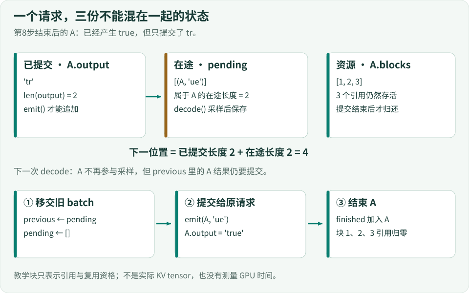
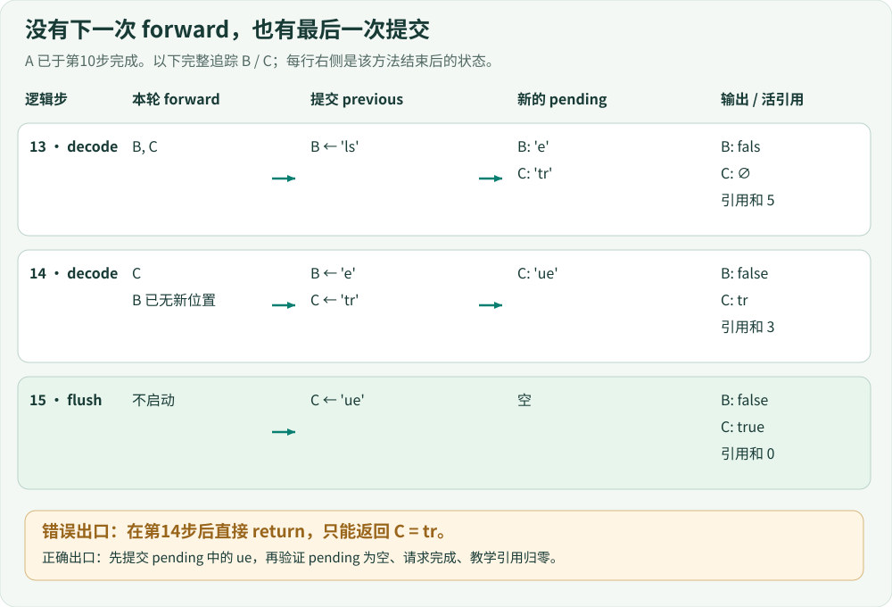
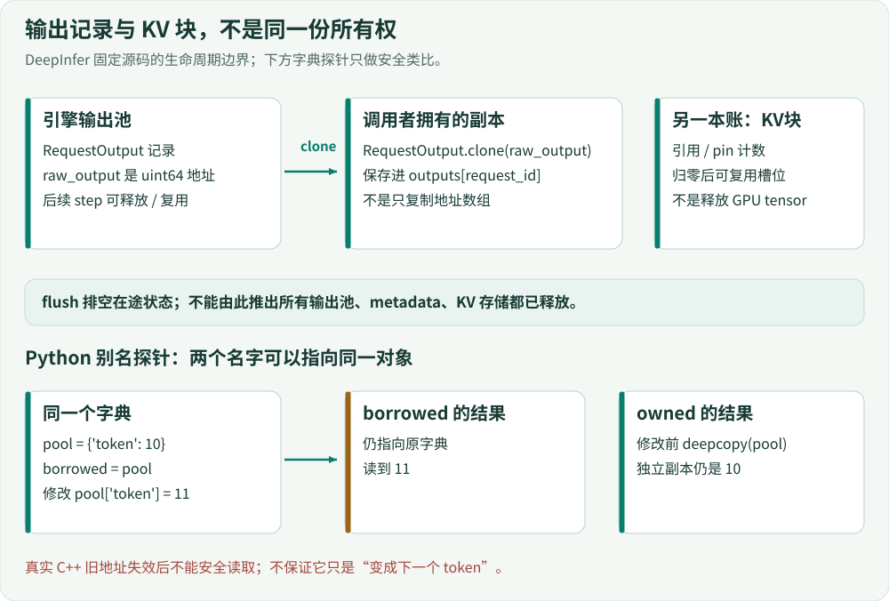

# 06 · 算出来了，为什么还不能结束？

> 本课把“采样”与“提交”拆开：新结果先进入 `pending`，旧结果由下一次生成步提交；没有下一步时，用 `flush()` 排空尾部。你将沿着同一批 A/B/C 请求，检查字符、请求身份和块引用是否一起走到正确终点。

## 1. 先停在一个看似可以返回的时刻

上一课的 `decode()` 生成一段字符后，立即调用 `emit()`。所以“已经生成”与“已经写进 `request.output`”恰好同时发生。为了表示延迟后处理，现在让这两件事相隔一次生成步。

输入不变：

| 请求 | prompt 长度 | 教学 oracle 的答案 | 预留教学块数 |
|---|---:|---|---:|
| A | 7 | `true` | 3 |
| B | 3 | `false` | 2 |
| C | 5 | `true` | 3 |

这里的答案是固定字符串，不是模型预测；每个字符只是教学单位。块数沿用上一课的 `ceil((prompt_length + answer_length) / 4)`，没有分配真实 KV tensor。

在仓库根目录运行：

```bash
python examples/s06_async_walkthrough.py
```

这个观察器直接使用[第06课完整引擎](../lessons/06_async_lifetime/code.py)，只在 `prefill()`、`decode()`、`flush()` 的边界记录快照，不更改调度或提交逻辑。找到这两个时刻：

```text
第14步之后：output = {A: true, B: false, C: tr}
             pending = [(C, ue)]，C.blocks = [6, 7, 8]
第15步flush后：output = {A: true, B: false, C: true}
               pending = []，全部块引用 = 0
```

第14步结束时，C已经产生全部4个字符，却只提交了前2个。如果此刻直接返回，调用者得到的是 `tr`；如果此刻把C的块交还给别的请求，资源生命周期也提前结束了。

**本课的问题不是“再算一次最后两个字符”，而是“把已经算出的最后两个字符交出去”。**

## 2. 给已生成、未提交的结果一个位置

我们需要同时记住三件不同的事：

| 状态 | 存放位置 | 谁修改它 | 它说明什么 |
|---|---|---|---|
| 已提交字符 | `request.output` | `emit()` | 调用者最终结果的一部分 |
| 已生成但未提交字符 | `self.pending`中的`(request, text)` | `decode()`入队，后处理取走 | 引擎还欠一次提交 |
| 请求持有的教学块 | `request.blocks` / `pool.refs` | prefill分配，完成时释放 | 资源还不能无条件复用 |



[放大查看状态图](../assets/async-state.svg)

`pending`保存的是**请求对象和这段字符的配对**，不只是一个无主字符串。A、B、C的活动顺序会变；后处理仍必须把B的`e`送给B，而不是送给“新batch里的第0项”。

新增的成员只有最后一行，其余是前课已有状态。来源：[Engine.__init__，109–111行](../lessons/06_async_lifetime/code.py#L109-L111)。

<!-- code: lessons/06_async_lifetime/code.py:L109-L111 -->
```python
self.pool = Blocks(10)  # 9 usable blocks, ID 0 reserved
self.verification_slots = 0
self.pending = []
```

`pending`是一个batch的容器，里面可能有多个请求。它不是长期输出历史，也不是“还能调度的请求”集合。`running`里暂时仍可能有已生成完、但尚未提交完的请求。

## 3. 一次生成步，按三个边界展开

本课的生成步是 `Engine.decode()`。它用 `forward`、`sample-pending` 这些事件名表示设备流水线的逻辑位置，**没有运行模型forward或异步线程**。

### 3.1 先确定下一段从哪里开始

来源：[decode，142–147行](../lessons/06_async_lifetime/code.py#L142-L147)。下面只调整换行，变量和语句与实现一致。

<!-- code: lessons/06_async_lifetime/code.py:L142-L147 -->
```python
def decode(self):
    active = list(self.running)
    # Snapshot positions include one in-flight batch; never resubmit its tokens.
    offsets = {
        r.request_id: len(r.output)
        + sum(len(t) for q, t in self.pending if q is r)
        for r in active
    }
    active = [r for r in active if offsets[r.request_id] < len(r.answer)]
    self.trace.append(('forward', [r.request_id for r in active]))
```

按第8步开始时的A计算：

| 项目 | 值 |
|---|---|
| `len(A.output)` | 0，上一段还未提交 |
| pending里属于A的字符数 | 2，即`tr` |
| `offsets['A']` | 0 + 2 = 2 |
| 下一段 | `answer[2:4]`，即`ue` |

如果只看 `len(A.output)`，起点仍是0，就会再次采样`tr`。所以必须在取走旧pending之前，保存“已提交 + 在途”的位置快照。

下一行过滤 `active` 也依赖这个位置。第14步开始时，B的`output='fals'`、pending为`e`，总长已达5；B不再参加本轮采样。C的`output=''`、pending为`tr`，总长只有2；C继续生成`ue`。**不再采样B，不等于可以丢掉B待提交的e。**

### 3.2 取走旧batch，再通过同一个emit提交

来源：[decode，148–152行](../lessons/06_async_lifetime/code.py#L148-L152)。

<!-- code: lessons/06_async_lifetime/code.py:L148-L152 -->
```python
previous, self.pending = self.pending, []
for request,text in previous:
    self.emit(request,text)
if not active:
    return
```

`previous, self.pending = self.pending, []`把旧列表交给局部变量，再给新一轮一个空列表。不是先清空旧列表再读取，也不是一边遍历一边把新结果追加进同一列表。

循环中仍调用原来的 `emit()`。它既追加输出，也承担“最后一次提交后结束请求”的职责。来源：[emit，113–121行](../lessons/06_async_lifetime/code.py#L113-L121)。

<!-- code: lessons/06_async_lifetime/code.py:L113-L121 -->
```python
def emit(self, request, text):
    request.output += text
    self.trace.append(('emit', request.request_id, text))
    if len(request.output) == len(request.answer):
        self.finished.add(request.request_id)
        self.running = [r for r in self.running if r is not request]
        for block in request.blocks:
            self.pool.free(block)
        request.blocks.clear()
```

注意三个先后关系：

1. 先追加字符，再判断提交长度是否到达答案长度。
2. 只有最后一次提交才把请求移出 `running`，加入 `finished`。
3. 之后才对该请求的每个block减引用，并清空它的block列表。

因此第14步处理B的`e`时，B的块4、5才释放；C只提交了`tr`，仍持有6、7、8。这里的“释放”是教学引用计数归零，不是归还GPU显存。

### 3.3 当前轮只采样，不提前提交

来源：[decode，153–162行](../lessons/06_async_lifetime/code.py#L153-L162)。

<!-- code: lessons/06_async_lifetime/code.py:L153-L162 -->
```python
allocation = choose([[.9,.5] for _ in active], [(2,1.0),(4,1.3),(8,3.0)])
lengths = allocation['query_lengths']
self.verification_slots += sum(lengths)
self.trace.append(('verify-plan', lengths))
for request,count in zip(active,lengths):
    start = offsets[request.request_id]
    text = request.answer[start:start+count]  # fake oracle, NOT a model
    if text:
        self.pending.append((request,text))
        self.trace.append(('sample-pending',request.request_id,text))
```

`choose()`沿用上一课的合成预算：本例单请求分到2个位置，B/C同时活跃时各分到2个。答案不足2字符时，Python切片只返回剩余字符，所以B最后得到`e`，不是凭空补齐2字符。

和上一课真正不同的是最后两行：这里不调用 `emit()`，而是把 `(request, text)`留在pending。第14步采出的C:`ue`要由后续提交路径处理。

把三段合起来，逻辑顺序是：

```text
保存包含pending的位置 → 标记本轮forward
→ 提交previous → 计算本轮采样配额 → 保存新的pending
```

本教学引擎的prefill步不会提交pending。例如第9步做prefill，A的`ue`一直等到第10步decode才提交。因此这里的“延迟一步”指**下一次decode调用**，不是固定等待一个tick，更不是实测时间。

## 4. 没有新工作，仍然要排空尾部

当所有生成位置都已覆盖时，再调用模型不是解决办法。`flush()`只做旧batch的提交，不做forward、不重新采样。来源：[flush，164–168行](../lessons/06_async_lifetime/code.py#L164-L168)。

<!-- code: lessons/06_async_lifetime/code.py:L164-L168 -->
```python
def flush(self):
    previous, self.pending = self.pending, []
    self.trace.append(('flush',len(previous)))
    for request,text in previous:
        self.emit(request,text)
```

这与decode中间的后处理段相同：先把pending取走，再逐项emit。取走后 `self.pending` 已为空，所以第二次flush没有字符可提交。它保证本例的重复排空不会再次追加尾部；**这不是崩溃重启下的exactly-once协议**。

谁来选择flush？在 `_run()` 中，终止判断不能只看“还有多少新位置要生成”。来源：[主循环，185–191行](../lessons/06_async_lifetime/code.py#L185-L191)，仅调整换行。

<!-- code: lessons/06_async_lifetime/code.py:L185-L191 -->
```python
while len(self.finished) < len(self.requests):
    self.ticks += 1
    if self.ticks > 1000:
        raise RuntimeError('teaching liveness guard: inspect trace')
    if not self.waiting and all(
        len(r.output) + sum(len(t) for q, t in self.pending if q is r)
        >= len(r.answer)
        for r in self.running
    ):
        self.flush()
        continue
```

这里有两个条件：waiting为空，说明没有未完成的prefill；每个running请求的“已提交 + 在途”已覆盖答案，说明不用再生成。满足它们后，做flush并回到while条件检查。只有 `finished` 的数量真正齐了，循环才结束。

第15步开始时，C的2个已提交字符加2个pending字符等于答案长4，所以进入flush；emit把`ue`提交后，C才进入finished并释放3块。

教学oracle预先知道答案长度，才能写出这个判断。真实推理通常根据EOS、停止条件与scheduler状态判断完成；不能把这个表达式直接移植成生产引擎的结束条件。

## 5. 让A/B/C贯穿时间线、输出和资源



[放大查看尾部时间线](../assets/async-timeline.svg)

下表来自观察器在**整个方法返回后**取得的快照。它与[交互取证台](09-evidence.md)的事件级trace使用同一引擎；事件级trace可能停在emit已追加输出、尚未释放块的函数内部，两种观察位置不能混用。

| tick / 方法结束点 | 已提交 A / B / C | pending | 仍持有的块 | 引用和 |
|---|---|---|---|---:|
| 7 / decode | ∅ / ∅ / ∅ | A:`tr` | A:1–3，B:4–5 | 5 |
| 8 / decode | `tr` / ∅ / ∅ | A:`ue` | A:1–3，B:4–5 | 5 |
| 9 / prefill | `tr` / ∅ / ∅ | A:`ue` | A:1–3，B:4–5，C:6–8 | 8 |
| 10 / decode | `true` / ∅ / ∅ | B:`fa` | B:4–5，C:6–8 | 5 |
| 11 / decode | `true` / `fa` / ∅ | B:`ls` | B:4–5，C:6–8 | 5 |
| 12 / prefill | `true` / `fa` / ∅ | B:`ls` | B:4–5，C:6–8 | 5 |
| 13 / decode | `true` / `fals` / ∅ | B:`e`，C:`tr` | B:4–5，C:6–8 | 5 |
| 14 / decode | `true` / `false` / `tr` | C:`ue` | C:6–8 | 3 |
| 15 / flush | `true` / `false` / `true` | 空 | 空 | 0 |

为什么B第7步就有块，却没有参与decode？它的prompt当时只处理了1/3，还在waiting；预留块并不等于可以生成。为什么C第13步有2字符pending却输出为空？因为采样和提交已经拆开。这张表同时包含前课的prefill、块所有权和本课的新状态，而不是三个互不相关的小例子。

观察器末尾还再次调用flush，检查emit事件没有增加。直接运行完整快照，则只运行引擎本身：

```bash
python lessons/06_async_lifetime/code.py
```

最终输出按原请求顺序返回 `['true', 'false', 'true']`。本课没有改变第01课的交付顺序契约。

## 6. DeepInfer里的对应边界在哪里？

以下对应固定提交 `9bd9cf243fc53ef9afbf8f04d391d989117d6ab9`。教学模型说明因果关系，不复刻CUDA执行。

### 6.1 step保存的不是几个字符，而是一整步执行状态

`LLMEngine.step()`调度后，经 `_execute_model_async_step()`进入 `Worker.execute_model_step()`。worker的顺序是发起当前forward → 等待并处理上一步post-process → 发起当前sample；ZOS decode把当前状态放进 `prev_step_state`。这个状态包含metadata、scheduler输出、sampler输出和完成event，不只是token字符串。[Worker执行入口](https://github.com/deepseek-ai/DeepInfer/blob/9bd9cf243fc53ef9afbf8f04d391d989117d6ab9/deepinfer/worker/worker.py#L89-L189)

这里的“发起”不表示设备工作已经完成。model runner在`forbid_cuda_sync`范围内发起forward和sample；CPU对上一轮的处理可以与当前设备工作重叠。只凭Python函数调用先后，不能画出“当前forward全部完成后才提交上一轮”的设备时间线。[模型与采样的发起边界](https://github.com/deepseek-ai/DeepInfer/blob/9bd9cf243fc53ef9afbf8f04d391d989117d6ab9/deepinfer/worker/model_runner.py#L308-L367)

要读懂“留到下一步”，先看这个实际分支。来源：同文件182–187行。

<!-- code: reference/DeepInfer/deepinfer/worker/worker.py:L182-L187 -->
```python
# 4. prompt 步或配置 non-ZOS 时当场 post process；ZOS decode 步留到下一步（与 forward 重叠）
if is_prompt or not envs.DEEPINFER_ZERO_OVERHEAD_SCHEDULING:
    request_outputs = np.concatenate([request_outputs, self._post_process_step(curr_step_state)])
    self.prev_step_state = None
else:
    self.prev_step_state = curr_step_state
```

prefill或关闭ZOS时，当场处理当前步；只有ZOS decode才保留它。所以**上游的下一次prefill同样会先处理previous**，与本课prefill不排空pending的简化不同。上游prefill还可以采样并提交第一个输出；教学prefill只推进prompt位置，不模拟首token的那次采样。

真正的CPU后处理要先等采样完成：`_post_process_step()`在读取结果前调用 `sample_end_evt.synchronize()`，再进入model runner和engine回调。不能把它理解成“等一个固定毫秒数”。[等待采样与后处理](https://github.com/deepseek-ai/DeepInfer/blob/9bd9cf243fc53ef9afbf8f04d391d989117d6ab9/deepinfer/worker/worker.py#L248-L272)

`prepare_zos_inputs()`还根据稳定seq_id把前后batch对应起来；顺序完全一致时走快路径，否则做remap。新请求不能误拿旧batch同下标的输出。这对应本课pending保留request身份，但真实实现使用GPU侧输出与元数据校正，并非只加一个Python长度。[请求重映射](https://github.com/deepseek-ai/DeepInfer/blob/9bd9cf243fc53ef9afbf8f04d391d989117d6ab9/csrc/engine/zos.cpp#L142-L187)

### 6.2 真实flush同样不发起新的forward

Worker的flush正文很短。来源：[worker.py，281–283行](https://github.com/deepseek-ai/DeepInfer/blob/9bd9cf243fc53ef9afbf8f04d391d989117d6ab9/deepinfer/worker/worker.py#L274-L283)。

<!-- code: reference/DeepInfer/deepinfer/worker/worker.py:L281-L283 -->
```python
request_outputs = self._post_process_step(self.prev_step_state)
self.prev_step_state = None
return request_outputs
```

它排空previous并置None。外层 `LLM._run_engine()` 在scheduler不再报告unfinished时仍调用一次flush，处理返回输出后才break。[调用者的最终排空](https://github.com/deepseek-ai/DeepInfer/blob/9bd9cf243fc53ef9afbf8f04d391d989117d6ab9/deepinfer/entrypoints/llm.py#L174-L186)

不要进一步推断“真实引擎的最后一个用户token一定在flush才返回”。上游尾步也可能是placeholder、空输出或请求已经结束后的待清理工作。两者共同的契约是**检查并排空在途状态**，不是保证每次flush都有可见字符。

## 7. 另一种所有权：返回记录也可能是借来的

pending决定结果何时提交；返回对象的生命周期决定结果交出去以后，调用者能保留多久。这是另一个问题，不能用“pending为空”代替检查。

先看一个可以独立运行的别名探针。来源：[borrowed_demo，26–31行](../examples/s06_async_lifetime.py#L26-L31)。

<!-- code: examples/s06_async_lifetime.py:L26-L31 -->
```python
def borrowed_demo():
    pool = {'token': 10}
    borrowed = pool
    owned = deepcopy(pool)
    pool['token'] = 11
    return borrowed['token'], owned['token']
```

`borrowed = pool`只给同一字典起了第二个名字。池内容改成11后，borrowed也读到11；owned是先前复制的对象，仍读到10。运行：

```bash
python examples/s06_async_lifetime.py
```

末行应为 `borrowed vs copied: (11, 10)`。这个字典实验只说明别名与拥有副本的差别；本课MiniInfer的output是不可变字符串，并没有伪装成C++输出对象池。



[放大查看所有权图](../assets/async-ownership.svg)

DeepInfer的step实际返回 `np.uint64` 数组，元素指向池里的C++ RequestOutput记录。下次step会释放/复用这些记录；保留一个整数地址不等于拥有记录。因此入口逐项clone，再按request_id保存。来源：[llm.py，177–182行](https://github.com/deepseek-ai/DeepInfer/blob/9bd9cf243fc53ef9afbf8f04d391d989117d6ab9/deepinfer/entrypoints/llm.py#L177-L182)，仅调整长行换行。

<!-- code: reference/DeepInfer/deepinfer/entrypoints/llm.py:L177-L182 -->
```python
unfinished = self.llm_engine.has_unfinished_requests()
step_outputs = (
    self.llm_engine.step() if unfinished
    else self.llm_engine.flush_inflight_reqs()
)
for raw_output in step_outputs:
    # clone step_outputs since step_outputs will be released in the next step
    output = RequestOutput.clone(raw_output)
    outputs[output.request_id].append(output)
```

[实际C++绑定](https://github.com/deepseek-ai/DeepInfer/blob/9bd9cf243fc53ef9afbf8f04d391d989117d6ab9/csrc/engine/pybind_output.cpp#L16-L18)复制的是地址指向的记录；只复制uint64地址数组并不取得这些记录的所有权。旧C++地址失效后不应继续读取，不保证它只会像字典探针那样“变成11”。

这里的实际API是 `RequestOutput.clone(raw_output)`，不是Python的 `deepcopy`；`deepcopy(sampling_params)`发生在另一个请求入队路径，也不是输出复制。

最后分清三类资源：

| 对象 / 边界 | 等待或释放依据 | 不应混同的概念 |
|---|---|---|
| sampler结果的CPU读取 | `sample_end_evt`完成后post-process | 不是凭“已发起sample”即可读取 |
| 元数据校正中的D2H读取 | `correction.d2h_evt` | 不是所有资源共用的完成event |
| clone相关的block/state unpin | clone完成事件与延迟释放管理 | 不是销毁调用者已clone的输出记录 |
| 池中RequestOutput记录 | 延迟回收，跨step保留要clone | 不是KV tensor本体 |
| KV块引用 | block管理器的引用与复用条件 | 引用归零不等于释放底层GPU缓存张量 |

上游flush负责drain与收集输出，没有调用统一延迟释放函数。因此本课最终“教学引用为零”的断言，不能被解释为真实引擎flush后所有池、metadata与GPU缓存都已清空。[延迟释放的分资源处理](https://github.com/deepseek-ai/DeepInfer/blob/9bd9cf243fc53ef9afbf8f04d391d989117d6ab9/deepinfer/engine/llm_engine.py#L100-L116) [池中记录的分配与销毁](https://github.com/deepseek-ai/DeepInfer/blob/9bd9cf243fc53ef9afbf8f04d391d989117d6ab9/csrc/engine/outputs.hpp#L45-L80)

`pre_sampler_sync`这个名字也不能当时序证明：当前源码是在 `execute_sample()`返回/工作入队后调用该回调，再记录sample_end_evt。需要以实际调用顺序、事件与资源归属判断能否释放，而不是只看函数名。[Worker，154–168行](https://github.com/deepseek-ai/DeepInfer/blob/9bd9cf243fc53ef9afbf8f04d391d989117d6ab9/deepinfer/worker/worker.py#L154-L168)

## 8. 故障对照：让每个状态承担一条断言

| 改动或错误假设 | 应观察什么 | 为什么能定位到本课机制 |
|---|---|---|
| 第14步后直接返回output | C仍为`tr`，pending仍有`ue`，还有3个块引用 | 无新生成位置不等于结果已提交 |
| 把offset改成仅`len(output)` | 单条A返回`trtr`；原A/B/C输入触发活性保护 | 起点遗漏了已生成但未提交的长度 |
| flush不清空pending | 第二次flush增加emit，或再次碰到已释放状态 | 提交所有权没有从pending移走 |
| 只保存借来的输出对象 | 池复用后，历史值跟着改变 | 保存引用/地址不等于取得拥有权 |

第一个反例是对上面实际第14步快照的提前返回推演，不是报告某次真实GPU推理丢了token。offset反例来自教学代码副本，只改变decode里的起点表达式，保留其他逻辑。flush不清空的反例是供练习验证的故障假设；字典别名的结果来自上面的独立探针。所有实验都不改上游实现，也不对真实显存做破坏性实验。

### 练习一：证明尾部恰好被提交一次

在[观察器](../examples/s06_async_walkthrough.py)里，找到第一次before-flush与after-flush，分别断言：

```python
assert before['output']['C'] == 'tr'
assert before['pending'] == [('C', 'ue')]
assert before['live_refs'] == 3
assert after['output']['C'] == 'true'
assert after['pending'] == []
assert after['live_refs'] == 0
```

再保存已有emit事件，调用第二次flush，断言emit列表完全不变。只比较最终字符串不够：重复提交又被截断的实现也可能掩盖错误，所以还要检查事件和资源。

### 练习二：为第14步写一个顺序测试

从 `engine.trace` 中截取第13步采样结束到最终flush之间的片段，确认以下事件顺序：

```text
forward ['C']
emit B 'e'
emit C 'tr'
verify-plan [2]
sample-pending C 'ue'
flush 1
emit C 'ue'
```

然后解释为什么第一项没有B，后面却仍有B的emit。答案应同时提到`offsets`过滤和previous结果的请求身份，不能只说“异步”。

### 练习三：删去pending长度，会发生什么？

复制第06课完整文件，只把decode的offset表达式中的pending求和去掉，保留主循环结束条件。先用单条A请求观察重复前缀，再用原A/B/C输入观察活性保护。不要把“没有抛异常”当通过：必须验证内容、完成集合、pending和块引用。

<details>
<summary>对照结果：为什么“资源清零”还不够？</summary>

单条A在第9步正常返回`['trtr']`，pending为空，块引用也为零，但内容已经错了。原A/B/C输入到第1001步触发`teaching liveness guard`，此时已提交内容是A:`trtrue`、B:`fafalse`、C:`trtr`；异常清理仍会将pending与块引用清零。正确的清理不能挽救错误的生成位置。

</details>

这课还没有引入语法matcher，因此不要把第08课的语法拒绝当成第06课必然的失败信号。用错误发生处已有的状态证明问题。

### 练习四：找出真实源码里的三个生命周期

沿上面的固定源码链接，分别标出：谁持有 `prev_step_state`、谁保存 `RequestOutput.clone` 的结果、谁控制KV块引用。各写一句“什么时候可以重用”，并指出它依赖的实际条件。不要给三者画同一条“step结束→全部释放”的箭头。

## 小结

本课没有增加模型能力，而是把此前重合的边界拆开了：采样产生pending，提交改变output，最后一次提交结束请求并归还教学块；没有下一次生成步时，flush负责收尾。跨step保存输出还要另行满足对象所有权契约。

下一课讨论有界重放：只有先知道哪些状态仍可被未来计算读取，才有资格删去旧计算或复用空间。

完整实现：[第06课code.py](../lessons/06_async_lifetime/code.py) · [相邻阶段差异](../lessons/06_async_lifetime/delta.patch) · [A/B/C观察器](../examples/s06_async_walkthrough.py)。上游代码片段保留DeepInfer固定提交来源，适用[Apache-2.0许可](../licenses/DeepInfer-Apache-2.0.txt)；教学边界与完整来源见[来源附录](13-sources.md)。
