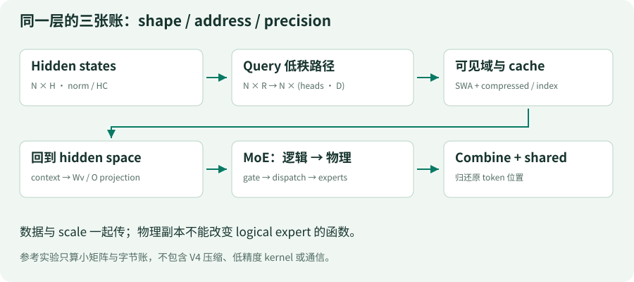
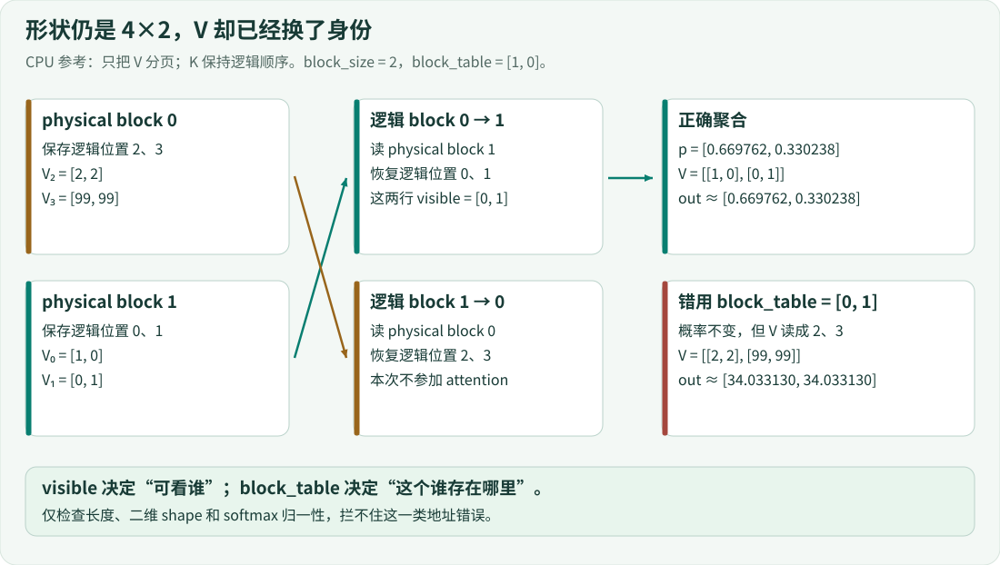
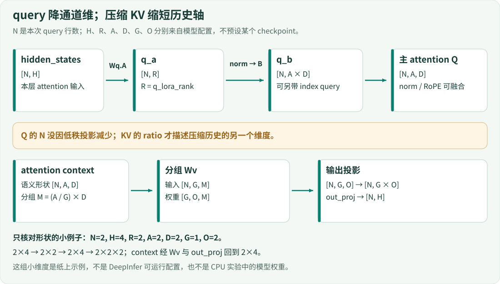
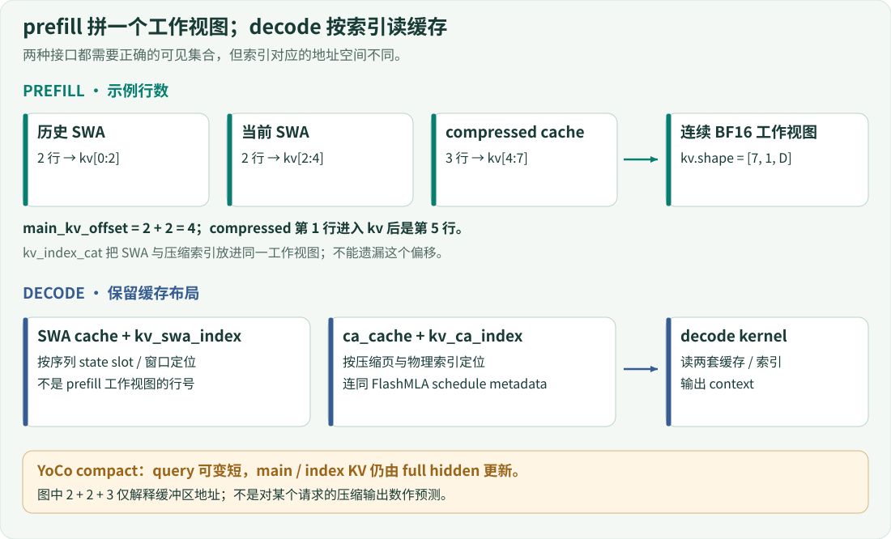
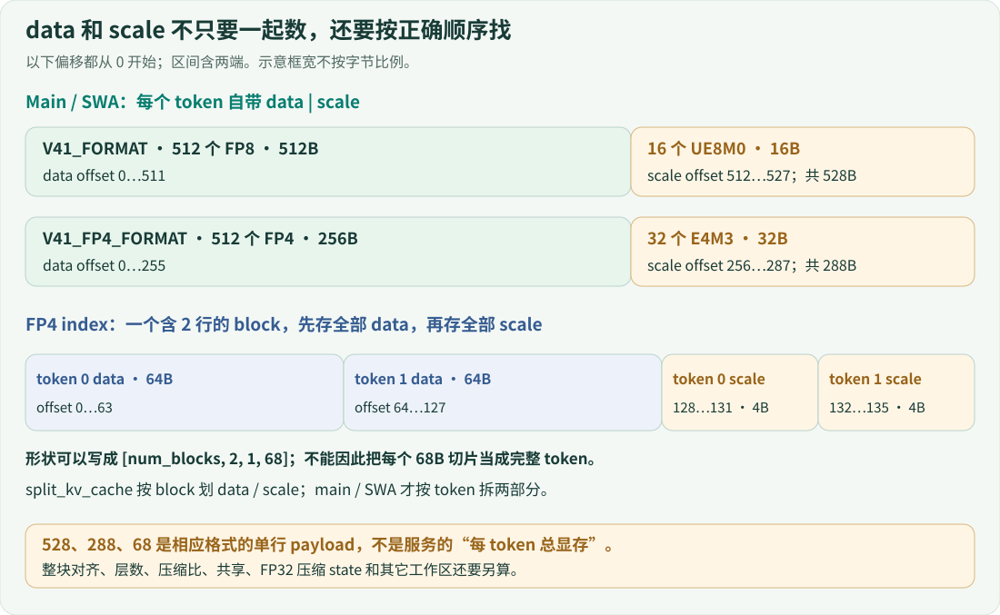
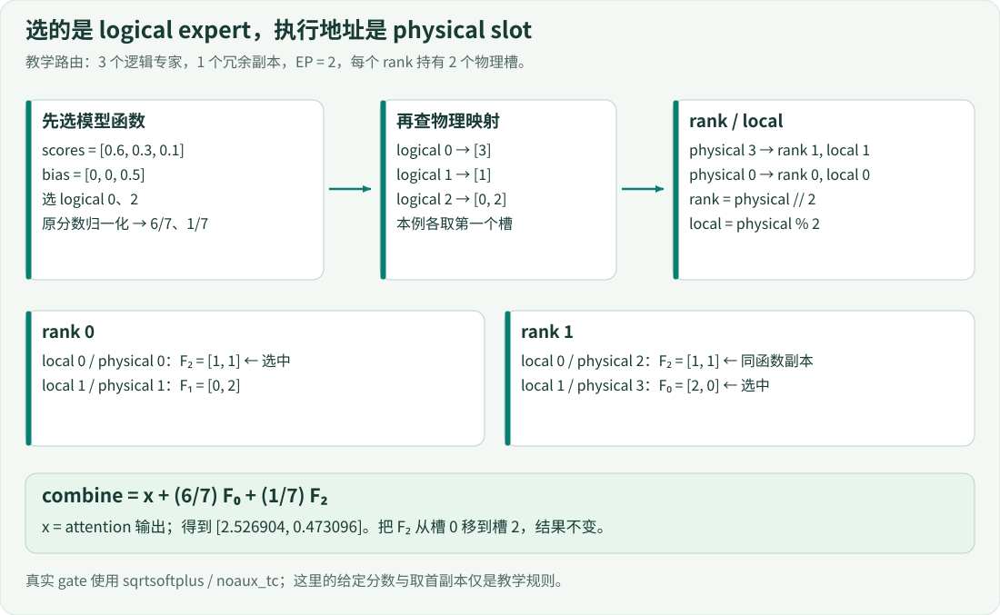

# 08+ · 计算路径的三张账本

> 调度器决定“谁在这一步计算”，计算层还必须回答“读哪一行、那行是什么格式、交给哪个函数”。本章用一组可手算的数值，把形状、地址与精度三张账对齐。专家编号是地址账的另一种表现：执行位置可以改变，函数身份不能改变。

## 1. 一个维度完全正确的错误

设 query 是 `[1, 0]`，只允许看逻辑位置 0、1。它们的 value 分别是 `[1, 0]`、`[0, 1]`。正确 attention 输出约为 `[0.669762, 0.330238]`。

现在只把缓存的块表写反，不改 query、不改 key、不改可见集合、不改任何矩阵维度。输出变成约 `[34.033130, 34.033130]`。softmax 仍归一化，但它把权重乘到了别人的 value 上。**合法的 shape 不能证明合法的身份。**

前面的 A/B/C 引擎只运送 oracle 字符，不执行模型。本章是独立的数学探针，不把这些小矩阵冒充 A/B/C 的真实 hidden states，也不将主线改造成假的 V4 模型。

在仓库根目录执行：

```bash
python examples/s10_tensor_path.py
python -m unittest discover -s tests -p 'test_tensor_path.py' -v
python -m unittest discover -s tests -p 'test_compute_walkthrough.py' -v
```

只使用 Python 标准库；不导入 torch、DeepInfer 或外部 kernel，不联网、不下载模型。第一条命令打印正确路径的数值；后两条检查正确路径及本章故障实验。



[放大查看计算路径](../assets/compute-path.svg)

读图时先分清三种箭头含义：模型数据流表示张量依赖；缓存读取表示位置到地址的转换；专家路由表示同一 token 在不同执行位置之间分发。它们不是一张 GPU 计时图。

## 2. 先确定谁可以参与 softmax

探针固定四个 key/value；当前只允许前两行参加聚合：

| 逻辑位置 | key | value | 本次可见？ |
|---|---|---|---|
| 0 | `[1, 0]` | `[1, 0]` | 是 |
| 1 | `[0, 1]` | `[0, 1]` | 是 |
| 2 | `[1, 1]` | `[2, 2]` | 否 |
| 3 | `[9, 9]` | `[99, 99]` | 否 |

下面是参考 attention 的完整实现，而不是另一个文件的功能摘要。

<!-- code: examples/s10_tensor_path.py:L7-L19 -->
```python
def attention(query, keys, values, visible):
    if not visible:
        raise ValueError('empty reference visibility')
    if len(keys) != len(values) or not query:
        raise ValueError('shape mismatch')
    if any(len(k) != len(query) for k in keys):
        raise ValueError('Q/K dimension mismatch')
    if any(len(v) != len(values[0]) for v in values):
        raise ValueError('V dimension mismatch')
    scores=[sum(a*b for a,b in zip(query,keys[i]))/math.sqrt(len(query)) for i in visible]
    peak=max(scores);weights=[math.exp(s-peak) for s in scores];denom=sum(weights)
    probs=[w/denom for w in weights]
    return [sum(p*values[i][d] for p,i in zip(probs,visible)) for d in range(len(values[0]))]
```

前半段拒绝空可见集、Q/K 维度不一致及 V 行宽不一致。它是实验函数，不是通用输入校验器：调用者仍须提供合法、唯一、非负的可见位置；Python 负下标会读取尾行，不能将其当成 padding sentinel。

后四行才是运算：

1. 对 `visible` 中的每个位置算 `q·k / sqrt(D)`。此处 D=2，分数是 `[1/sqrt(2), 0]`，约 `[0.707107, 0]`。
2. 减去最大分数再取指数。两项为 `[1, exp(-1/sqrt(2))]`，约 `[1, 0.493069]`。共同平移不改变 softmax，但避免正指数过大。
3. 除以总和得到 `[0.6697615493, 0.3302384507]`。可见集里只有两项，位置 3 的巨大 key 不进入分母。
4. 用同一个逻辑位置索引 value，逐维加权。因为两行 V 是二维基向量，输出恰好显示两项概率。

如果把不可见行先算进 softmax，再只在最后丢掉其 value，那些行已经改变分母，结果仍会错。遮罩约束的是参与归一化的集合，不只是最后输出是否显示某行。

这一参考使用普通 Python float，没有 attention sink、RoPE、MLA 压缩、HC 或真实低精度算术；上游的 attention 不能逐行替换成它。它保留的只是可见集合、归一化和聚合必须共同使用正确身份这一契约。

## 3. 块表把逻辑位置翻译成物理地址

每块有两行。为了让地址转换可见，刻意把逻辑前两行放入物理块 1，把后两行放入物理块 0：

<!-- code: examples/s10_tensor_path.py:L21-L25 -->
```python
def paged_view(blocks, block_table, length):
    flat=[token for physical in block_table for token in blocks[physical]]
    if length > len(flat) or length < 0:
        raise ValueError('block table cannot cover length')
    return flat[:length]
```

`block_table` 按**逻辑块顺序**列出物理块号。因此 `[1, 0]` 不是要交换 token 语义，而是用乱序存储恢复原语义。函数先按块表展开，再裁到实际长度；`length=3` 只返回逻辑位置 0、1、2，而不是整个末块。容量不足或负长度会报错，物理块号的合法性仍由调用者负责。



[放大查看正确与错误的分页映射](../assets/compute-paged-identity.svg)

本探针只将 V 分页，K 仍保持逻辑顺序。这种故障安排有意让 attention 权重不变，只观察 value 身份错配；它不是 DeepInfer 完整的 paged KV 布局。

以下命令可直接重现，不需要修改源码：

```bash
python - <<'PYCODE'
import sys
sys.path.insert(0, 'examples')
from s10_tensor_path import attention, paged_view
keys = [[1.,0.], [0.,1.], [1.,1.], [9.,9.]]
values = [[1.,0.], [0.,1.], [2.,2.], [99.,99.]]
stored = [values[2:], values[:2]]
for table in ([1,0], [0,1]):
    restored = paged_view(stored, table, 4)
    print(table, restored, attention([1.,0.], keys, restored, [0,1]))
PYCODE
```

| 块表 | 可见 V 两行 | attention 输出（六位小数） |
|---|---|---|
| `[1,0]` | `[1,0]`、`[0,1]` | `[0.669762, 0.330238]` |
| `[0,1]` | `[2,2]`、`[99,99]` | `[34.033130, 34.033130]` |

错误值每个分量都是 `0.6697615493×2 + 0.3302384507×99`。这解释了为什么“形状正确、输出有限、概率和为 1”三项检查同时通过，仍不能证明读到了正确缓存。

## 4. 回到真实 query：低秩缩的是通道，不是位置

令 N 为本 step 的 query 行数，H 为 hidden size，R 为 query low-rank 维度，A 为头数，D 为 head dim。query 主路径是 `N×H → N×R → norm → N×(A·D)`，然后组织多头 query。不能把 R 与 KV 压缩历史的 ratio 混成一个参数。



[放大查看形状账](../assets/compute-query-path.svg)

图中纸上尺寸 `N=2,H=4,R=2,A=2,D=2` 表示两行 query 一直是两行；只是每行经过 4→2→4 个通道。context 再按 G 组做 Wv，展平分组输出并投影回 H。图中数值用于核对形状，不是有效 checkpoint 配置，也不是 CPU 探针暗中运行的权重。

固定源码的 `ColumnParallelLora` 分别创建 A 与可选 B；A 可以带额外 RoPE 通道，故简单形状链只描述其主 query 分支。[源码 · A/B 投影容器](https://github.com/deepseek-ai/DeepInfer/blob/9bd9cf243fc53ef9afbf8f04d391d989117d6ab9/deepinfer/model_executor/models/v4_modules/mla_attn.py#L26-L60)

实际 decoder 还包含 HC norm/residual、可选 Engram 干预与 DFlash 数据采集，不是标准残差块换一个名字。RoPE、q norm 与 cast 也可能融合进 kernel；Python 层少一次调用不等于数学运算消失。[源码 · decoder 编排](https://github.com/deepseek-ai/DeepInfer/blob/9bd9cf243fc53ef9afbf8f04d391d989117d6ab9/deepinfer/model_executor/models/decoder_layer.py#L112-L182)

### prefill 与 decode 的索引不在同一个地址空间

下面直接摘出 prefill 三段工作视图的计数。注释中的 cache 指历史 SWA，当前 SWA 另占一段。

<!-- code: reference/DeepInfer/deepinfer/model_executor/models/v4_modules/attn.py:L813-L818 -->
```python
# Assemble the input kv for prefill attention: [swa cache | current swa kv | compressed cache]
total_k_swa_cached = input_metadata.total_k_swa if self.use_swa else 0
total_k_swa_cur = (input_metadata.mirror_cp_reverse_index.shape[0] if use_cp else kv_swa.shape[0]) if self.use_swa else 0
total_k_compressed = input_metadata.total_k_compressed[self.ratio_key] if self.has_packed_kv else 0
total_kv = total_k_swa_cached + total_k_swa_cur + total_k_compressed
main_kv_offset = total_k_swa_cached + total_k_swa_cur
```

若历史 SWA 有 2 行、当前 SWA 有 2 行、压缩 cache 有 3 行，则 `total_kv=7`、`main_kv_offset=4`。压缩部分的局部第 1 行进入工作视图后是全局第 5 行，而不是第 1 行。后续 `kv_index_cat` 将 SWA 与 compressed indices 合到这个地址空间中。



[放大查看 prefill/decode 的地址空间](../assets/compute-prefill-decode.svg)

decode 的 SWA 分支则将两套 cache 与各自索引分别传给 kernel：

<!-- code: reference/DeepInfer/deepinfer/model_executor/models/v4_modules/attn.py:L641-L647 -->
```python
attn_kv_args = dict(
    key_cache=kv_cache.swa_cache,
    indices_in_kvcache=kv_swa_index,
    key_cache_extra=kv_cache.ca_cache,
    indices_in_kvcache_extra=kv_ca_index,
    index_length_extra=dense_index_len,
)
```

这里 `indices_in_kvcache` 对应 SWA，`indices_in_kvcache_extra` 对应 compressed cache。直接把 prefill 拼接视图的行号送给 decode，会把一种坐标当成另一种坐标。真实调用还传入 FlashMLA schedule metadata、sink、batch-invariant 设置与融合 norm/RoPE 参数。[源码 · 两种 attention 接口](https://github.com/deepseek-ai/DeepInfer/blob/9bd9cf243fc53ef9afbf8f04d391d989117d6ab9/deepinfer/model_executor/models/v4_modules/attn.py#L589-L670)

YoCo compact 可以减少 query 行数，却不能由此推导 KV 只需同样短的历史。源码的 `_store_yoco_full_kv` 使用 full hidden 更新 main/index KV；这是第 07 课“少算前先证明仍可见”的计算层对应物。[源码 · full KV 更新](https://github.com/deepseek-ai/DeepInfer/blob/9bd9cf243fc53ef9afbf8f04d391d989117d6ab9/deepinfer/model_executor/models/v4_modules/attn.py#L672-L721)

## 5. 一个 token 的 payload，不等于它的全部内存

参考函数只计算数据与 scale 的字节和：

<!-- code: examples/s10_tensor_path.py:L42-L45 -->
```python
def kv_bytes(elements,bits,per_scale,scale_bytes):
    if elements<1 or bits not in (4,8) or per_scale<1 or scale_bytes<1 or elements*bits%8:
        raise ValueError('invalid packed format')
    return elements*bits//8 + math.ceil(elements/per_scale)*scale_bytes
```

`elements*bits//8` 是打包后的数据字节数；`ceil(elements/per_scale)` 是 scale 组数，不满一组也需要一个 scale。函数要求数据位数恰好组成整字节，因此 3 个 FP4 元素在此接口中会被拒绝，不会默默少算半字节。

固定源码明确区分格式参数，例如 FP4 index：

<!-- code: reference/DeepInfer/deepinfer/model_executor/layers/tilelang_ops/cache_common.py:L129-L137 -->
```python
FP4_INDEX_KV_FORMAT = KVCacheFormat(
    quantized_dtype="e2m1",
    quantized_elements=128,
    elements_per_sf=32,
    bf16_elements=0,
    do_cast=False,
    sf_format="ue8m0",
    note="V4/V41, index kv.",
)
```

128 个元素、每个 4 bit，共 64B；每 32 个元素配一个 1B UE8M0 scale，共 4B。因此 payload 为 68B，而不是 64B。其 `token_interleaved` 没有设为 True，沿用 False；这会影响数据与 scale 的排列，不能只读最后一维 68 就假定每行独立记录。

| 格式 | 数据计算 | scale 计算 | 每行 payload |
|---|---|---|---:|
| V41_FORMAT | `512×8/8 = 512B` | `512/32×1 = 16B` | 528B |
| V41_FP4_FORMAT | `512×4/8 = 256B` | `512/16×1 = 32B` | 288B |
| FP4_INDEX_KV_FORMAT | `128×4/8 = 64B` | `128/32×1 = 4B` | 68B |



[放大查看 data 与 scale 的实际字节顺序](../assets/compute-cache-bytes.svg)

图中两行 FP4 index 的有效载荷共 136B：前 128B 是两行数据，后 8B 是两行 scale。所以“第一个 token 的 68B 连续切片”实际混入了第二个 token 的前 4B 数据，根本不是完整的 token 记录。

此外，分配器会将 block stride 向对齐边界补齐。这个 136B index block 按 32B 对齐后 stride 为 160B；payload 与物理跨块步长是不同数字。main/SWA 使用另一条对齐规则，其 `token_interleaved` 还影响返回视图的 stride。[源码 · 缓存格式与分配](https://github.com/deepseek-ai/DeepInfer/blob/9bd9cf243fc53ef9afbf8f04d391d989117d6ab9/deepinfer/model_executor/layers/tilelang_ops/cache_common.py#L24-L162) [源码 · alloc_kv_cache](https://github.com/deepseek-ai/DeepInfer/blob/9bd9cf243fc53ef9afbf8f04d391d989117d6ab9/deepinfer/model_executor/layers/tilelang_ops/cache_common.py#L255-L274)

真实 `KVCache` 还区分 ca_cache、ica_cache、swa_cache 及 FP32 压缩 state。层数、压缩比例、跨层共享、保留窗口与临时缓冲也都影响总量。不能把 68、288 或 528 乘原始 token 数，就叫做整个模型或服务显存。[源码 · KVCache 与 StateBlock](https://github.com/deepseek-ai/DeepInfer/blob/9bd9cf243fc53ef9afbf8f04d391d989117d6ab9/deepinfer/worker/cache_engine.py#L206-L242)

## 6. 专家位置改变，函数身份不改变

教学 route 用给定分数隔离“选择”和“寻址”。这里不是实现真实 gate 的 sqrtsoftplus/noaux_tc，也不模拟负载均衡策略。

<!-- code: examples/s10_tensor_path.py:L27-L36 -->
```python
def route(scores,bias,topk,logical_to_physical):
    """Toy: correction changes selection; raw positive scores define normalized weights.
    This is NOT a reimplementation of tile_kernels sqrtsoftplus/noaux_tc.
    """
    if len(scores)!=len(bias) or not 1<=topk<=len(scores) or any(x<0 for x in scores):
        raise ValueError('invalid toy gate inputs')
    chosen=sorted(range(len(scores)),key=lambda i:(-(scores[i]+bias[i]),i))[:topk]
    total=sum(scores[i] for i in chosen)
    if total<=0:raise ValueError('zero route weight')
    return [(i,logical_to_physical[i][0],scores[i]/total) for i in chosen]
```

逐步代入 `scores=[0.6,0.3,0.1]`、`bias=[0,0,0.5]`、`topk=2`：

1. 用于选取的值是 `[0.6,0.3,0.6]`，因此选 logical 0、2。相等时用 logical ID 升序打破平局。
2. 权重来自所选项的**原始分数**，不是加偏置后的分数。分母为 0.7，权重是 6/7 与 1/7，不是各 1/2。
3. 查映射 `0:[3]、1:[1]、2:[0,2]`，每项取第一个物理副本，得到 `(logical, physical, weight)`：`(0,3,6/7)`、`(2,0,1/7)`。



[放大查看专家身份](../assets/compute-expert-identity.svg)

假设四个物理槽平均分到两个 rank，每 rank 两槽，则 physical 3 属于 rank 1 的 local 1，physical 0 属于 rank 0 的 local 0。logical 2 还有 physical 2 这个副本，位于另一个 rank；它必须实现相同 F₂，而不是变成 F₀ 或 F₁。

固定源码也把 logical、physical、local 分开，并要求 physical 数能被 EP size 整除。shared expert 不在这些 routed 副本编号里。[源码 · 专家参数与编号](https://github.com/deepseek-ai/DeepInfer/blob/9bd9cf243fc53ef9afbf8f04d391d989117d6ab9/deepinfer/model_executor/models/v4_modules/moe.py#L1-L112)

探针 combine 使用 logical ID 取函数输出，忽略 physical 字段：

<!-- code: examples/s10_tensor_path.py:L38-L40 -->
```python
def combine(x,routes,expert_outputs):
    """Fixed outputs stand in for grouped GEMM/SwiGLU; x is a toy shared path."""
    return [x[d]+sum(weight*expert_outputs[logical][d] for logical,_,weight in routes) for d in range(len(x))]
```

这不是漏做通信，而是把“换副本不换函数”单独变成可测试性质。`expert_outputs` 的固定向量代替 grouped GEMM/SwiGLU；x 直接作为教学 shared 路径，并非真实 shared expert 网络。

令 F₀=`[2,0]`、F₂=`[1,1]`，x 是前面的 attention 输出，则：

```text
第一维 = 0.6697615493 + (6/7)×2 + (1/7)×1 = 2.5269044065
第二维 = 0.3302384507 + (6/7)×0 + (1/7)×1 = 0.4730955935
```

把 logical 2 的映射从 `[0,2]` 改为 `[2,0]`，route 的物理字段变化，combine 仍须相同。若按 physical ID 索引 `expert_outputs`，可能立刻 KeyError，也可能取到另一个恰好存在的向量并静默出错；不能把“不报错”当正确。

真实常规路径执行 gate→dispatch→grouped GEMM→SwiGLU→grouped GEMM→combine，并处理 shared 路径。某些设备、精度和互联域可以走 mega-MoE 融合分支，不能把常规 Python 路径宣称为所有配置的必经路线。[源码 · MoE runtime](https://github.com/deepseek-ai/DeepInfer/blob/9bd9cf243fc53ef9afbf8f04d391d989117d6ab9/deepinfer/model_executor/models/v4_modules/mlp.py#L149-L616)

## 7. 同一输入的完整数值走读

主程序的输入与调用接线如下：

<!-- code: examples/s10_tensor_path.py:L48-L53 -->
```python
keys=[[1.,0.],[0.,1.],[1.,1.],[9.,9.]]
values=[[1.,0.],[0.,1.],[2.,2.],[99.,99.]]
# Physical block 1 contains logical positions 0..1, physical 0 contains 2..3.
stored=[values[2:],values[:2]]
out=attention([1.,0.],keys,paged_view(stored,[1,0],4),[0,1])
routes=route([.6,.3,.1],[0.,0.,.5],2,{0:[3],1:[1],2:[0,2]})
```

上面的 `out` 进入 combine，地址映射与专家路由没有各自使用一套无关数据。执行后的关键结果如下，表中只是显示时四舍五入；测试用浮点容差比较，不比较字符串位数。

| 边界 | 输入中的关键身份 | 实际结果 |
|---|---|---|
| paged_view | block_table=`[1,0]` | 恢复原始四行 V |
| attention | visible=`[0,1]` | `[0.6697615493, 0.3302384507]` |
| route | logical 0、2 | physical 3、0；weight 6/7、1/7 |
| combine | x 加两项逻辑函数 | `[2.5269044065, 0.4730955935]` |
| kv_bytes | 三种格式参数 | 528、288、68B |

这些结果证明普通浮点参考中的可见性、映射和加权关系，不证明 DeepInfer kernel 的数值等价或设备性能。

精度也不是整网一个开关：真实 FP8 linear 携带 `(data, scale)`，有 scale packing、TMA/stride 对齐要求；MoE 区分 fp8×fp4、fp8×fp8、bf16×bf16，gate 投影保持 BF16。即使浮点值、shape 相同，scale 语义或 stride 错误也能让 kernel 读错。[源码 · linear 精度与布局](https://github.com/deepseek-ai/DeepInfer/blob/9bd9cf243fc53ef9afbf8f04d391d989117d6ab9/deepinfer/model_executor/layers/linear.py#L10-L174)

## 8. 练习：让错误在正确的边界暴露

先写下预期再执行。每题都在本章标准库探针上操作，不要求安装上游。

### 练习 A：改一个不可见位置

把 K₃ 和 V₃ 改为非常大的有限数值，保持 `visible=[0,1]`。比较完整输出，而不只判断“没有异常”。然后将 visible 改为 `[0,1,3]`，解释为什么结果此时可以变化。

**答案**：前者不变，因为位置 3 不参与 score、分母或聚合；后者是在改变计算问题，不再要求旧输出。不要用 NaN/Inf 作为这个有限值实验的替代，它们引入了另一类数值语义。

### 练习 B：概率正确为什么还会读错？

运行第 3 节命令，只将块表 `[1,0]` 改成 `[0,1]`。检查两组输出的维度相同，再手算错误值。提出一项能抓住错误的断言。

**答案**：错误值两维均约 34.033130。`paged_view(stored,[1,0],4)==values` 能直接保护地址恢复；只检查 softmax 和为 1 不能。还应在非单位块表下比较逻辑 view 与分页 view 的最终 attention。

### 练习 C：副本能否改变模型结果？

将 logical 2 的映射改为 `[2,0]`；再删除 logical 2 的映射。分别预测 route 与 combine。

**答案**：换副本仅改变 route 中 physical 0→2，combine 不变。删映射会在 route 查字典时报 `KeyError(2)`，当前探针不会静默回落到同编号物理槽；若要扩展成面向用户接口，应在执行前显式校验缺失项与空副本列表，而不是吞掉异常返回零向量。

### 练习 D：68B 的行为什么不能直接切？

纸上写出两行 FP4 index：data0 占 0–63，data1 占 64–127，scale0 占 128–131，scale1 占 132–135。问：切片 `[68:136]` 是第二个 token 的完整记录吗？块 stride 是 136B 吗？

**答案**：都不是。该切片丢掉 data1 的前 4B，并混入 scale0。有效 payload 为 136B，但按 32B 对齐的 block stride 为 160B。dtype/shape 描述容器，不能替代 typed view 与 stride 契约。

### 练习 E：这组数能否证明真实 FP4 精度？

为将来的真机数值对比列一份输入契约，解释本章的 byte accounting 缺少什么。

**答案**：至少记录 shape、dtype、stride、scale 编码/组大小、位置索引、设备、kernel/图模式与误差容限。字节数相等不证明舍入、饱和、反量化或累加精度相同；本章没有执行这些算术，也没有 GPU benchmark。

## 本章留下的检查习惯

遇到错误输出，先分别问三张账：**shape 的轴表示什么、位置映射是否保留身份、每字节与 scale 的解释是否一致**。再去查运行时间。下一章将这条原则用于指标：先数清实际交付了什么，再讨论快了多少。
