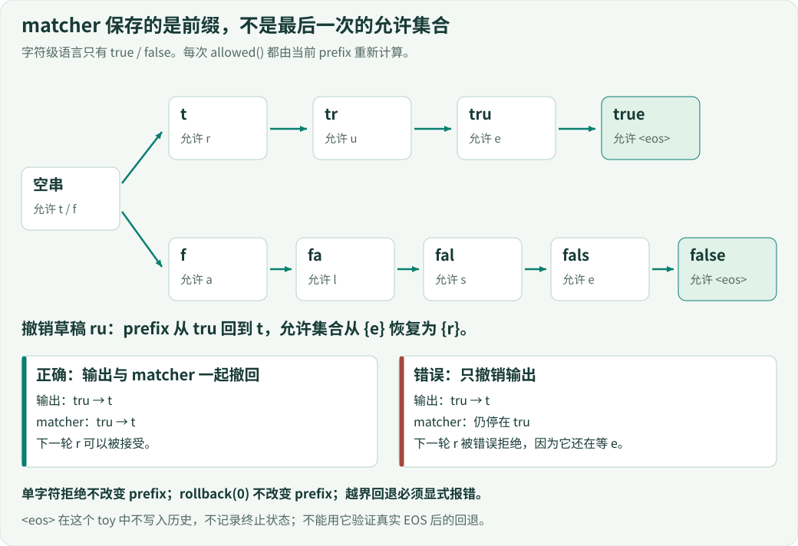
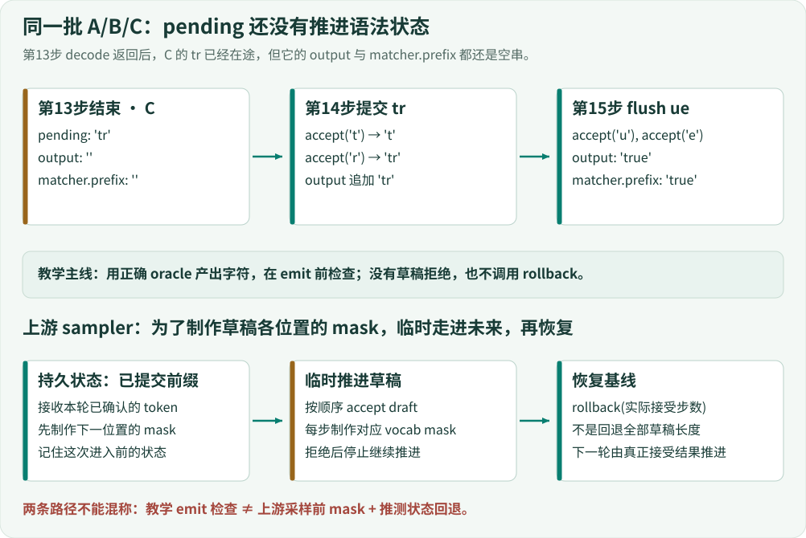

# 08 · token 回退，语法也要回退

> 接受一个字符，同时改变了两件事：输出前缀与下一步允许集合。撤销草稿时，这两个状态必须回到同一位置。本课用只接受 `true / false` 的字符状态机隔离这个关系；它不是 JSON Schema、tokenizer 或 xgrammar 实现。

## 1. 一个“字符串修好了，生成却坏了”的反例

设已接受 `tru`，下一步只允许 `e`。现在撤销最后两个字符 `ru`，输出回到 `t`。如果 matcher 还停在 `tru`，下一轮正确的 `r` 反而会被拒绝。最后再做一次 `json.loads` 无法修复这个问题：错误发生在生成过程中，每一步可选什么已经被错误状态限制。



[放大查看状态机](../assets/grammar-state.svg)

沿图上方的路径读：空串允许 `{t,f}`，`t` 允许 `{r}`，`tr` 允许 `{u}`，`tru` 允许 `{e}`，完整 `true` 允许 `{<eos>}`。下方路径同样把 `false` 拆成五次状态迁移。箭头表示接受字符，不表示一次 GPU kernel，也不表示固定耗时。

本课要分别检查三个契约：

1. **单次拒绝不推进状态**：拒绝 `x` 以后，prefix 与 allowed 都不变。
2. **回退恢复允许集合**：回到 `t`，下一步应该重新允许 `r`。
3. **已提交与在途分开**：教学引擎里，pending 的字符尚未推进 matcher；成功 emit 后两者才一致。

在仓库根目录执行：

```bash
python examples/s08_grammar_rollback.py
python examples/s08_grammar_walkthrough.py
python lessons/08_grammar_rollback/code.py
python -m unittest discover -s tests -p test_grammar_chapter.py -v
```

前三个入口只运行标准库教学代码，无模型、网络或设备依赖。短探针输出 `after tru: {'e'}`，随后输出 `after rollback 2: t {'r'}`。完整快照仍应交付 `['true', 'false', 'true']`、15个逻辑tick、13个提交字符。

## 2. 允许集合不是“合法单词列表”

每个请求拥有自己的 Matcher。它只保存当前前缀，不保存完整词法树；在两个允许单词中筛选仍以此前缀开头的词，再取各词的下一个字符。

<!-- code: lessons/08_grammar_rollback/code.py:L106-L115 -->
```python
class Matcher:
    words = ('true', 'false')
    def __init__(self):
        self.prefix = ''

    def allowed(self):
        result = {w[len(self.prefix)] for w in self.words if w.startswith(self.prefix) and len(w)>len(self.prefix)}
        if self.prefix in self.words:
            result.add('<eos>')
        return result
```

以 prefix=`t` 代入第一个集合推导：`true.startswith('t')` 为真，其下标1是`r`；`false.startswith('t')` 为假，因此结果只有`r`。prefix=`true` 时，长度检查阻止读取越界下标4，而完整词判断加入`<eos>`。

这里有两个容易混淆的单位：prefix 按 Python 字符增长，真实引擎的 mask 按 tokenizer 的词表 token ID 索引。一个真实 token 可以包含多个字符，甚至与当前字节边界有关。不能把这个字符集合直接写成真实模型的词表 mask。

为A、B、C各建一个matcher的实际接线如下：

<!-- code: lessons/08_grammar_rollback/code.py:L156-L157 -->
```python
for request in requests:
    request.matcher = Matcher()
```

如果把同一个matcher分给三个请求，A接受`t`后，B的`f`就会因A的历史被拒绝。这与第01课的输出身份问题相同：状态必须跟着请求走，不能跟着batch位置或全局变量走。

## 3. accept与rollback：先检查，再修改

<!-- code: lessons/08_grammar_rollback/code.py:L117-L128 -->
```python
def accept(self, token):
    if token not in self.allowed():
        return False
    if token != '<eos>':
        self.prefix += token
    return True

def rollback(self, steps):
    if not 0 <= steps <= len(self.prefix):
        raise ValueError('rollback exceeds history')
    if steps:
        self.prefix = self.prefix[:-steps]
```

`accept()`先查询allowed，非法字符直接返回False，不执行追加。因此“单次失败不修改prefix”由代码顺序保证。`<eos>`合法时返回True，但不写入prefix。这是教学限制：没有单独的finished标志，也没有EOS历史；连续两次接受`<eos>`都会返回True。

`rollback()`先检查步数是否在0到历史长度之间。越界抛错，不允许悄悄截断全部历史。`if steps`不是可有可无：Python的`-0`仍是0，`prefix[:-0]`得到空串，而不是原串。

逐步手算短探针，再用观察器核对：

| 动作 | 返回值 | prefix | 下一步allowed |
|---|---|---|---|
| 初始 | — | 空串 | `f,t` |
| accept t | True | `t` | `r` |
| accept r | True | `tr` | `u` |
| accept u | True | `tru` | `e` |
| rollback 2 | None | `t` | `r` |
| accept x | False | `t` | `r` |
| rollback 0 | None | `t` | `r` |

回退的不是“已经输出给外部用户的事实”。这个探针模拟可撤销的内部历史；真实流式服务必须另外定义哪些token已交付且不可撤销。把内部草稿回滚直接套在外部流输出上，会引入另一种协议错误。

## 4. 接入累计引擎：在什么时刻推进语法？

上一课已有异步pending和flush。本课没有重写decode，也没有引入真正的拒绝采样；它把检查放在`emit()`里。

<!-- code: lessons/08_grammar_rollback/code.py:L159-L170 -->
```python
def emit(self, request, text):
    for token in text:
        if not request.matcher.accept(token):
            raise ValueError(f'grammar rejected {token!r} after {request.matcher.prefix!r}')
    request.output += text
    self.trace.append(('emit', request.request_id, text))
    if len(request.output) == len(request.answer):
        self.finished.add(request.request_id)
        self.running = [r for r in self.running if r is not request]
        for block in request.blocks:
            self.pool.free(block)
        request.blocks.clear()
```

先对本次text中的每个字符调用accept，全部通过后才把整段追加到output并记录emit。当output长度等于已知oracle答案长度时，完成请求并归还教学块。注意结束依据仍是oracle长度，不是`matcher.allowed()`中的EOS，也不是模型生成停止信号。



[放大查看提交边界图](../assets/grammar-commit.svg)

本课实际的在途提交接线仍是：

<!-- code: lessons/08_grammar_rollback/code.py:L199-L203 -->
```python
previous, self.pending = self.pending, []
for request,text in previous:
    self.emit(request,text)
if not active:
    return
```

decode先把旧pending移到previous，并清空新pending；随后逐请求emit旧结果。新的oracle字符被放进下一批pending，不在这里接收。因此C在第13步已经采样出`tr`时，matcher仍为空，不可提前拿`tr`对应的允许集合代替已提交状态。

最后一批通过同一个emit入口落账：

<!-- code: lessons/08_grammar_rollback/code.py:L215-L219 -->
```python
def flush(self):
    previous, self.pending = self.pending, []
    self.trace.append(('flush',len(previous)))
    for request,text in previous:
        self.emit(request,text)
```

flush没有另一套语法规则。它只是取出剩余pending，逐条调用相同的提交检查。若flush也写了一份不同的matcher推进逻辑，尾部便可能与普通decode走出不同状态。

## 5. 同一批A/B/C的真实方法边界

`examples/s08_grammar_walkthrough.py`导入第08课引擎，仅在prefill、decode和flush返回后记录输出、matcher、pending和引用数。下表来自该入口的实际执行，不是手写的采样动画。

| tick结束 | A/B/C输出，同时等于各自prefix | pending | live refs |
|---:|---|---|---:|
| 7 | 空 / 空 / 空 | A:`tr` | 5 |
| 8 | `tr` / 空 / 空 | A:`ue` | 5 |
| 9 | `tr` / 空 / 空 | A:`ue` | 8 |
| 10 | `true` / 空 / 空 | B:`fa` | 5 |
| 11 | `true` / `fa` / 空 | B:`ls` | 5 |
| 12 | `true` / `fa` / 空 | B:`ls` | 5 |
| 13 | `true` / `fals` / 空 | B:`e`, C:`tr` | 5 |
| 14 | `true` / `false` / `tr` | C:`ue` | 3 |
| 15 | `true` / `false` / `true` | 空 | 0 |

第9和12步是prefill，不提交pending，所以前缀保持不变。第13步B只差一个`e`，C的第一段`tr`也已在途，两条请求的身份都必须保留；不能因C尚未有输出就丢掉它。第14步B完成释放其块，C仍持有3个引用；第15步flush推进C的`u,e`后才全部归零。

这些成功方法边界满足`request.output == request.matcher.prefix`。但这不等于所有异常位置也满足，更不等于emit有事务回滚。

## 6. 一段text的失败，不是一次字符失败

构造单请求oracle=`tx`。一次emit可能先接受`t`，再拒绝`x`。此时循环没有执行到output追加，结果是：

- matcher.prefix为`t`；
- output仍为空串；
- run抛出ValueError；
- 该请求不在finished；异常清理后pending为空，块引用为0。

这组结果由`test_partial_chunk_is_not_transactional`实际断言。它不违反单字符reject契约：失败的`accept('x')`没有改变状态；变化发生在前一次成功的`accept('t')`。不能把“单次拒绝不推进”扩大成“整个emit原子提交”。

引擎的异常策略是整批中止并清理资源，而不是恢复matcher继续运行：

<!-- code: lessons/08_grammar_rollback/code.py:L221-L233 -->
```python
def run(self):
    try:
        return self._run()
    except Exception:
        # Teaching policy: fail this whole batch, then release every live owner.
        for request in self.requests:
            for block in request.blocks:
                self.pool.free(block)
            request.blocks.clear()
        self.waiting.clear()
        self.running.clear()
        self.pending.clear()
        raise
```

因此不要捕获异常后直接复用这个engine继续调度。如果要做可恢复的教学扩展，需保存emit前的matcher状态，失败时回退实际成功的字符数，并定义output、trace、finished、资源变化的事务边界。真实上游的失败策略也不是这里的整批fail-fast；sampler会将相应请求的SO状态置为失败，避免一个结构化输出错误拖垮全部请求。

## 7. 上游的mask为何需要“先走进未来，再退回来”？

以下引用固定为DeepInfer `9bd9cf243fc53ef9afbf8f04d391d989117d6ab9`。它们是源码阅读，不是本教程执行的GPU路径。[上游sampler完整上下文](https://github.com/deepseek-ai/DeepInfer/blob/9bd9cf243fc53ef9afbf8f04d391d989117d6ab9/deepinfer/model_executor/layers/sampler.py#L332-L387)。

当SO状态已初始化，sampler先接收上一步真正接受的token，形成持久基线；再为下一位置生成词表mask。接着要准备草稿后续各位置的mask，每个位置的合法集合依赖前面草稿。因此它临时接受草稿，再恢复到基线：

<!-- code: reference/DeepInfer/deepinfer/model_executor/layers/sampler.py:L366-L376 -->
```python
num_accepted_steps = 0
for k, draft_token in enumerate(seq_metadata.last_next_n_token):
    if matcher.accept_token(draft_token):
        if matcher.constrained():
            mask_filled = matcher.fill_vocab_mask(self.bitmasks_cpu[k + 1], idx)
            assert mask_filled, f"填充第 {k + 1} 步 draft so mask 失败"
            so_indices_cpu[k + 1].append(idx)
        num_accepted_steps += 1
    else:
        break
matcher.rollback(num_accepted_steps)
```

设持久prefix是`t`，草稿为`r,x,u`。临时接受`r`后状态变成`tr`，可以为下一位置生成只允许`u`的mask；`x`被拒绝，循环停止。实际接受步数是1，不是草稿长度3；所以rollback应回退1步恢复`t`。如果回退3步，就会越过基线或触发历史不足错误。

这里的mask在采样与草稿验证前应用，而教学主线只是拿已知oracle的字符在emit时检查。两者不能混称为同一个结构化采样实现。主线没有调用rollback；回退机制由独立探针与测试覆盖。

### trigger、bound和EOS不是普通字符前缀

真实`XGrammarMatcher`还维护trigger进度、KMP失败函数、已保留进度历史、进入matcher的token数、bound后步数和EOS后步数。trigger未完成而bound已触发时，只能接受trigger的下一个token；未bound时，KMP允许在任意生成历史中识别trigger。约束生效与否由这些状态共同决定，而不是简单判断prefix非空。

真实EOS回退的开头如下：

<!-- code: reference/DeepInfer/deepinfer/structure_output/matcher.py:L206-L221 -->
```python
def rollback(self, steps: int) -> None:
    if self.finished():
        steps_after_eos = min(steps, self.tokens_after_eos)
        self.tokens_after_eos -= steps_after_eos
        steps -= steps_after_eos

    if steps == 0:
        return

    if self.tokens_after_eos >= 0:
        self.tokens_after_eos = -1

    steps_in_matcher = min(steps, self.tokens_in_matcher)
    if steps_in_matcher > 0:
        self.inner_matcher.rollback(steps_in_matcher)
        self.tokens_in_matcher -= steps_in_matcher
```

先消耗EOS之后额外走过的步数；若仍需回退，取消finished状态，再回退内部matcher实际持有的token。这说明为什么字符toy不能验证真实EOS恢复：toy根本没存这些计数。后续源码还恢复trigger历史并调整bound计数；保留历史有限，越界会显式报错。[上游完整rollback](https://github.com/deepseek-ai/DeepInfer/blob/9bd9cf243fc53ef9afbf8f04d391d989117d6ab9/deepinfer/structure_output/matcher.py#L206-L232)

### 恢复请求：编译完成还不够

`SOMatcherBuilder`在线程池构建matcher。恢复已有token的请求时，要逐个replay；一个被拒绝，就不能假装状态恢复成功：

<!-- code: reference/DeepInfer/deepinfer/structure_output/so_matcher_builder.py:L87-L92 -->
```python
for i, token in enumerate(replay_tokens):
    if not matcher.accept_token(int(token)):
        raise RuntimeError(
            f"SO replay failed: token {token} (idx {i}/{len(replay_tokens)}) rejected during matcher state restore"
        )
return matcher
```

这段在构建任务内部执行，返回matcher之前就完成replay。主线程的pump只处理已经有结果的future，把matcher挂回原sequence，再调用on_ready使它进入后续调度：

<!-- code: reference/DeepInfer/deepinfer/structure_output/so_matcher_builder.py:L109-L121 -->
```python
def pump(self) -> None:
    """轮询 pending，把已编完的 seq 出队并 on_ready 入调度。"""
    if not self._pending:
        return
    still_pending = []
    for seq, future, on_ready in self._pending:
        matcher = future.try_result()  # 非阻塞，超时返回 aborted_matcher
        if matcher is None:
            still_pending.append((seq, future, on_ready))
            continue
        seq.so_matcher = matcher
        on_ready(seq)
    self._pending = still_pending
```

`None`表示还没有结果，继续保留pending；非None也可能是超时或失败的aborted matcher，不能把“future完成”一概当成成功。sampler还会检查is_aborted并将请求判失败。线程池只填future，不直接操作sequence入调度逻辑，这保留了主线程对队列和身份的控制。[构建与pump上下文](https://github.com/deepseek-ai/DeepInfer/blob/9bd9cf243fc53ef9afbf8f04d391d989117d6ab9/deepinfer/structure_output/so_matcher_builder.py#L45-L129)

## 8. 约束正确与可复现，是不同验收轴

合法JSON不意味着每次产生相同token；相同token也不意味着满足业务schema。固定seq_seed控制每请求随机性，但不能独自消除不同batch引起的数值差异。

固定版本README对确定性采样给出的组合条件是NVIDIA平台、`DEEPINFER_BATCH_INVARIANT=1`、`DEEPINFER_ENABLE_MTP_VARLEN=0`以及固定`seq_seed`。未传seed时SamplingParams会生成随机64位值。这个组合来自上游支持说明，不是CPU模拟器的测试结论。[确定性配置](https://github.com/deepseek-ai/DeepInfer/blob/9bd9cf243fc53ef9afbf8f04d391d989117d6ab9/README.md#L23-L31) [seed实现](https://github.com/deepseek-ai/DeepInfer/blob/9bd9cf243fc53ef9afbf8f04d391d989117d6ab9/deepinfer/sampling_params.py#L13-L119)

上游batch-invariant测试把同一prompt单独运行与放入batch运行，比较token、logprob、top token和top logprob，并借助golden trajectory对应。只检查“最后都能解析”或“读起来差不多”不具备这种判别力。[测试比较路径](https://github.com/deepseek-ai/DeepInfer/blob/9bd9cf243fc53ef9afbf8f04d391d989117d6ab9/tests/models/test_batch_invariant.py#L1-L116)

## 9. 练习、预期观察与答案

### 练习一：拒绝与零步回退

建立prefix=`t`，尝试`accept('x')`，再调用rollback(0)、rollback(-1)、rollback(2)。逐次断言prefix和allowed，不只断言异常类型。

**答案：**拒绝返回False，零步回退返回None，两者均保持`t`和`{'r'}`。后两个越界回退抛ValueError，且抛错之前尚未改prefix。若把rollback中的`if steps`删掉，零步回退会错误清空字符串。

### 练习二：共享前缀与歧义

在独立探针中把words扩为`('true','false','try')`。运行到`tr`，再分别接受`u`和`y`（使用两个独立matcher）。

**答案：**`tr`允许`{'u','y'}`；`tru`只允许`e`，`try`只允许`<eos>`。集合推导必须保留所有匹配词，而不是找到第一个前缀就return。若增加`'t'`本身，prefix=`t`应同时允许EOS及后续字符，这是“可结束但也可继续”的状态。

### 练习三：临时草稿的实际回退计数

matcher先接受`t`，记录基线。草稿`r,x,u`逐项尝试，遇到拒绝停止，累计成功次数后rollback。比较恢复前后的prefix与allowed。

**答案：**只接受一个`r`，拒绝`x`，不会尝试`u`；rollback(1)恢复`t`和`{'r'}`。不应回退3步，更不能把拒绝字符也算进成功历史。该练习模拟mask准备的状态恢复关系，不证明真实tokenizer mask正确。

### 练习四：失败与资源清理不是同一个证明

用oracle=`tx`运行完整引擎。断言output、prefix、finished、pending、refs五项，然后判断能否直接重试同一对象。

**答案：**output空、prefix=`t`、未finished、pending空、refs为0。资源清理成功不等于语法状态回滚成功；该对象已中止，不能宣称可恢复。若设计事务性emit，应增加“部分成功后拒绝”的测试，而不只测试首字符就是非法的`wrong`。

### 练习五：真实上游测试矩阵

| 场景 | 必须检查的结果 | 最小验证层 |
|---|---|---|
| trigger尚未完成 | KMP进度与回退后的进度一致 | matcher及tokenizer依赖 |
| bound刚触发 | 下一mask只开放预期trigger token | matcher与词表mask |
| EOS之后回退 | EOS后计数、finished及内部状态一致 | matcher单测 |
| trigger历史越界 | 明确失败，不伪造恢复状态 | matcher单测 |
| 编译超时/失败 | aborted结果保留请求身份，不当成功 | builder/future测试 |
| replay拒绝 | 构建失败，不把错误前缀排入成功路径 | builder恢复测试 |
| batch变化但相同seed | token与各项概率逐项比较 | 支持硬件上的模型运行 |

**答案要点：**前六项不必依靠完整大模型生成才能设计断言，但仍可能需要真实xgrammar、tokenizer、torch或相应测试替身；本书的标准库toy没有执行这些上游测试。最后一项不能由toy trace确定性推出。

## 本课小结

语法约束是一份随生成历史推进的状态，不是生成结束时才检查的字符串。拒绝、临时推进、回退、在途提交与失败清理各有不同边界。下一课把同样的思路用于计数：真正交付了多少，不能拿曾经验证过多少来替代。
