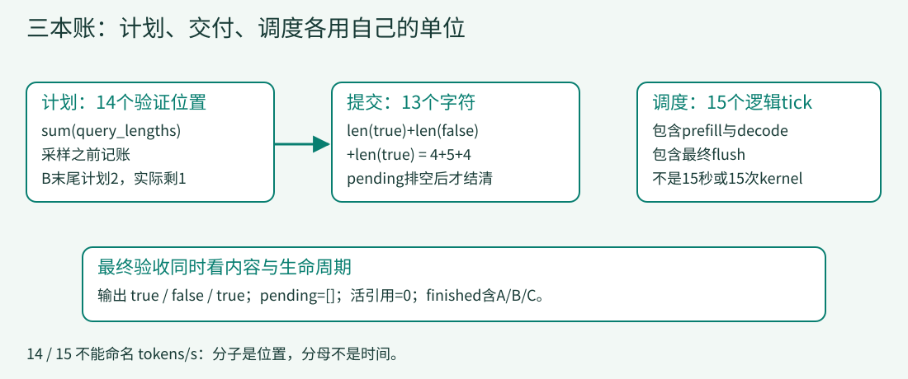

# 09 · 先数对，再说快

> 给已有系统加最后一本账：做过多少验证工作，交付了多少结果，经历了多少逻辑循环。将三个数放在一起检查，不给任何一个随意加上“每秒”。

## 一份看似更漂亮的成绩单

同一A/B/C需要4+5+4=13个输出字符，最终引擎却累计分配了14个验证位置。如果把14当成交付量，就凭空多出了一个字符；如果再除以15个逻辑tick，把结果命名为tokens/s，就同时偷换了字符/token和tick/秒两个单位。

运行最终完整系统：

```bash
python lessons/09_metrics/code.py
python examples/observe_lesson.py 9
python examples/check_system.py
```

应得到：`true / false / true`、`verification_slots=14`、`committed_characters=13`、`logical_ticks=15`。结束时pending为空、全部教学块引用归零。无模型、无GPU、无真实性能计时。



[放大查看测量账本图](../assets/metrics-ledger.svg)

## 1. 一个计数器必须说清在哪里增加

验证工作量在第05课选择好长度之后增加，发生于输出真正提交之前。最终引擎仍保留这个顺序：

<!-- code: lessons/09_metrics/code.py:L205-L207 -->
```python
lengths = allocation['query_lengths']
self.verification_slots += sum(lengths)
self.trace.append(('verify-plan', lengths))
```

每条请求的长度相加得到本轮分配的位置数。它既不是graph容量，也不是最终可见字符数；第13步B剩一个`e`，仍获得2位置，差额就在这里出现。

提交量则从每请求实际output长度求和，不从验证计划反推。来源：[report，256–260行](../lessons/09_metrics/code.py#L256-L260)。

<!-- code: lessons/09_metrics/code.py:L256-L260 -->
```python
def report(self):
    return {'outputs':[r.output for r in self.requests], 'logical_ticks':self.ticks,
            'verification_slots':self.verification_slots,
            'committed_characters':sum(len(r.output) for r in self.requests),
            'measurement':'logical simulation only; no tokens/s or device timing'}
```

返回字段明确写`logical_ticks`、`verification_slots`和`committed_characters`，并附带`measurement`范围。计数器命名本身就是接口契约的一部分。第08课已有这个运行状态，第09课主要把它以可检查的报告形式暴露出来，不再引入另一个调度算法。

## 2. 14、13、15分别从哪里来？

第06课以后，sample-pending与emit隔开，不能在一次sample后立刻把候选数加到“用户得到的量”。

| tick | 本轮采样计划 | 新pending内容 | 本轮提交previous | 累计验证位置 |
|---:|---|---|---|---:|
| 7 | A:2 | A:tr | 无 | 2 |
| 8 | A:2 | A:ue | A:tr | 4 |
| 10 | B:2 | B:fa | A:ue | 6 |
| 11 | B:2 | B:ls | B:fa | 8 |
| 13 | B:2，C:2 | B:e，C:tr | B:ls | 12 |
| 14 | C:2 | C:ue | B:e，C:tr | 14 |
| 15 | 无新采样 | 空 | C:ue，flush | 14 |

验证计划总和为2+2+2+2+4+2=14，实际字符串总长为13。15是整个主循环次数，包含prefill、空decode、生成、最终flush；它不是15次等价的GPU kernel。

假如在tick14直接统计最终交付，会看到C只有`tr`；如果只检查verification_slots，又会误以为所有工作已经完成。所以集成验收必须同时检查内容、pending、结束状态和资源，而不是只有一个总数。

## 3. 把九课契约连起来运行

`examples/check_system.py`直接调用每课的同一A/B/C输入，不重写lesson源码。它先检查交付顺序和内容，再检查相关阶段已经引入的资源与pending状态，最后独立检查最终报告。

还包括两条失败/压力路径：第03课7个可用块时C必须等待A释放；第08课非法oracle必须报错并清理。它不把失败后的资源清零当作内容成功，异常本身必须符合预期。

这些检查证明的是MiniInfer在这些输入下的离散行为，不证明DeepInfer设备正确性或分布式无死锁。判断一次修改是否破坏课程机制，应先找**第一个不同的状态转移**，而不是从最后一个失败断言猜原因。

## 4. 官方吞吐公式究竟数了什么？

真实benchmark先从稳态窗口里筛掉带flush标记的区间，再计算steps/s。来源：[measure_decode，397–409行](https://github.com/deepseek-ai/DeepInfer/blob/9bd9cf243fc53ef9afbf8f04d391d989117d6ab9/examples/benchmark.py#L397-L409)。

<!-- code: reference/DeepInfer/examples/benchmark.py:L397-L409 -->
```python
def measure_decode() -> dict[str, float]:
    """稳态窗口的 decode 原始量；窗口内无 flush-clean 区间时返回空 dict。"""
    clean = [ts - prev[0] for prev, (ts, flushed) in pairwise(stable_decode) if not flushed]
    if not clean:
        return {}
    avg_sps = len(clean) / sum(clean)
    return {
        "decode_window_steps": len(clean),
        "decode_avg_sps": avg_sps,  # VARLEN=0 下每 step 恒提交 1+nextn 个 token，故与接受率无关
        "decode_max_step_ms": max(clean) * 1000,
        # 满接受口径：每 step 每请求按 1 + nextn 个 token 计，换 τ 从 decode_avg_sps 重算
        "decode_tokens_per_s_per_gpu": avg_sps * args.decode_num_requests * (envs.DEEPINFER_USE_NEXTN_DECODE + 1) / cp_size,
    }
```

`len(clean)/sum(clean)`是干净区间内的step速率；max(clean)又提供最慢单步毫秒数，不能把两者当成同一个统计。没有干净区间时返回空字典，而不是编一个零吞吐点。

最后一行是**满接受口径**：SPS × 本地请求数 × (1+nextn) / CP。这里必须一起读数据采集方式、请求数的局部语义和并行拓扑，不能再无依据地除一次全局EP卡数，也不能把报告口径等同于任意在线请求的实收token吞吐。

绘图脚本为固定draft长度提供另一个假设接受率口径，并明确拒绝VARLEN重标定。来源：[decode_tau，58–61行](https://github.com/deepseek-ai/DeepInfer/blob/9bd9cf243fc53ef9afbf8f04d391d989117d6ab9/examples/sweep/plot_pareto.py#L58-L61)。

<!-- code: reference/DeepInfer/examples/sweep/plot_pareto.py:L58-L61 -->
```python
def decode_tau(points: list[dict], draft_acceptance: float) -> float:
    """τ = 1 + nextn × a：每 step 期望接受 nextn × a 个 draft token，另加 1 个主模型 token。"""
    assert not points[0]["mtp_varlen"], "VARLEN=1 时 avg_SPS 已含接受率，不能再乘 τ；这组数据不能用本口径出图"
    return 1 + points[0]["nextn"] * draft_acceptance
```

原因是VARLEN下测得SPS已经受动态验证量与接受行为影响，不能保持SPS不变再乘一个新接受率，仿佛只改了纵轴单位。

## 5. 用纯算术复算一次，不把它叫benchmark

来源：[decode_metrics，2–8行](../examples/s09_metrics.py#L2-L8)。

<!-- code: examples/s09_metrics.py:L2-L8 -->
```python
def decode_metrics(sps, requests, nextn, cp, acceptance=1.0, varlen=False):
    if varlen:
        raise ValueError('fixed-length acceptance rescaling is invalid for VARLEN=1')
    if sps <= 0 or requests < 1 or cp < 1 or nextn < 0 or not 0 <= acceptance <= 1:
        raise ValueError('invalid metric inputs')
    tau = 1 + nextn * acceptance
    return {'tokens_per_user_s': sps*tau, 'tokens_per_s_per_gpu':sps*requests*tau/cp, 'assumed_tokens_per_step':tau}
```

```bash
python examples/s09_metrics.py
```

输入SPS=20、requests=64、nextn=5、CP=1：

- 满接受时τ=1+5=6，每用户口径120，整合每卡口径7680。
- 假设接受率0.75时τ=4.75，每用户口径95，每卡口径6080。
- varlen=True时必须报错，不允许把同一条SPS曲线这样重标定。

这些数来自手填输入，没有测出任何GPU每秒6080 token。算术探针只负责验证单位和公式，不负责证明acceptance假设成立。

## 6. 比较实验之前，固定什么？

官方绘图脚本检查同组数据的model、EP、CP、context、nextn、VARLEN及额外专家数等字段一致；同一个扫描点重复运行时取最后记录，没有有效指标的记录会跳过。[数据一致性检查](https://github.com/deepseek-ai/DeepInfer/blob/9bd9cf243fc53ef9afbf8f04d391d989117d6ab9/examples/sweep/plot_pareto.py#L22-L55)

一个可复查的真实实验至少还需要权重版本、硬件拓扑、输入长度分布、缓存前缀/后缀、warmup和稳态窗口、原始计数与计时、日志及失败/N/A记录。profiler、负载均衡统计flush和测量窗口也不能混为一谈。没有对应设备与运行记录时，本教程不替读者填写这些结果。

## 7. 集成练习：取消如何穿过整台引擎？

不要一次加入服务网络、优先级和真实模型。只为当前MiniInfer设计取消，先写出下面的可观察契约：

1. waiting取消：不再prefill；已经预留的块是否归还？
2. running取消：不再参加新的验证计划；已经提交的字符是否返回？
3. pending取消：在途字符丢弃还是排空？无论选哪一种，必须说明且只处理一次。
4. 重复取消：不得再次减少引用或重复提交。
5. grammar状态：取消后是否还允许新的accept或rollback？如何防止迟到回调修改已结束请求？

先明确策略，再实现一个统一终止入口。验收除了最终output，还应检查finished/cancelled分类、pending所有者、活引用以及迟到事件。真实上游另有abort、异步matcher与延迟释放路径，不能只把一个Python列表清空视作服务级取消。

### 参考答案：一种明确但非唯一的取消策略

可以选择“保留已提交前缀、丢弃未提交pending”：waiting/running移除并进入cancelled集合，过滤该请求的pending，再归还它持有的块并清空其块列表；重复取消先查终态直接返回。emit必须拒绝已取消身份，grammar也不能再accept。测试应覆盖取消前有/无pending、重复取消、迟到emit以及共享owner。这里给出的是待实现策略，不声称当前引擎已支持取消；真实设备工作不能靠移除Python对象立即终止，释放时机还要受设备事件约束。

## 运行取证台

网页可以逐事件查看已有MiniInfer真实运行记录。选择阶段与场景后，状态来自trace.append发生时的快照；它不是手工动画，也不是GPU时间线。

<!-- TRACE_EXPLORER -->

Markdown与无脚本阅读使用下面同源的静态表。注意方法结束快照与事件内部快照的差别：emit事件刚记录时，输出已经追加，后面的free可能尚未执行。静态终态以complete为准。

### 静态取证表

快照抓取在 trace.append 的准确时刻；例如 emit 事件已更新输出，但随后执行的资源释放可能尚未发生。最后 complete 快照才是最终资源验收。

| 阶段 / 场景 | 逻辑 tick | 最终输出 | 最终块引用和 | pending |
|---|---:|---|---:|---:|
| 01 A/B/C 基准轨迹 | 5 | true / false / true | 0 | 0 |
| 03 内存背压 · 6 条请求 | 22 | false / false / false / false / false / false | 0 | 0 |
| 06 A/B/C 基准轨迹 | 15 | true / false / true | 0 | 0 |
| 09 A/B/C 基准轨迹 | 15 | true / false / true | 0 | 0 |

#### 最终阶段的关键事件

以下为实际运行事件。运行 `python scripts/make_evidence.py` 可在 `reports/trace-data.json` 重新生成完整记录。

| 事件号 | tick | 动作 | 已提交输出 A / B / C | pending |
|---:|---:|---|---|---|
| 0 | 0 | initial | ∅ / ∅ / ∅ | [] |
| 6 | 3 | prefill A 4 | ∅ / ∅ / ∅ | [] |
| 13 | 6 | prefill A 3 | ∅ / ∅ / ∅ | [] |
| 15 | 6 | prefill B 1 | ∅ / ∅ / ∅ | [] |
| 20 | 7 | sample-pending A 'tr' | ∅ / ∅ / ∅ | [('A', 'tr')] |
| 25 | 8 | sample-pending A 'ue' | tr / ∅ / ∅ | [('A', 'ue')] |
| 27 | 9 | prefill B 2 | tr / ∅ / ∅ | [('A', 'ue')] |
| 29 | 9 | prefill C 2 | tr / ∅ / ∅ | [('A', 'ue')] |
| 35 | 10 | sample-pending B 'fa' | true / ∅ / ∅ | [('B', 'fa')] |
| 40 | 11 | sample-pending B 'ls' | true / fa / ∅ | [('B', 'ls')] |
| 42 | 12 | prefill C 3 | true / fa / ∅ | [('B', 'ls')] |
| 48 | 13 | sample-pending B 'e' | true / fals / ∅ | [('B', 'e')] |
| 49 | 13 | sample-pending C 'tr' | true / fals / ∅ | [('B', 'e'), ('C', 'tr')] |
| 55 | 14 | sample-pending C 'ue' | true / false / tr | [('C', 'ue')] |
| 56 | 15 | flush 1 | true / false / tr | [] |
| 58 | 15 | complete | true / false / true | [] |

