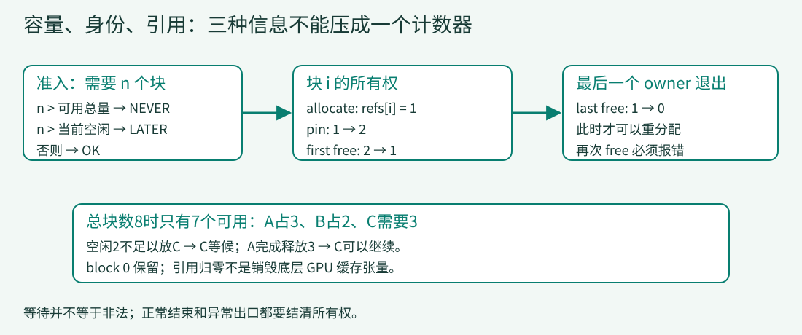

# 11 · 读懂一个状态迁移

> 读源码不只是认出函数名。用一块被两个 owner 持有的内存，练习从实现提取前置条件、状态变化和可观察结果，再明确结论在哪一层有效。

## 1. 先写一个可以被推翻的问题

“free会释放内存”太模糊。更精确的问题是：**共享块被释放一次后，其他请求能否立刻重新分配它？** 如果引用计数是2，答案应该是否定的；只有最后一次释放让它归零，块才能重回空闲集合。



[放大查看所有权图](../assets/block-ownership.svg)

这张图是状态说明，不是设备执行记录。第03课用整数数组模拟所有权；真实C++同时维护引用计数和空闲链表。两者都能解释“第一次free不等于可复用”，却不能因此断言它们拥有相同的并发或异常行为。

```bash
python examples/s11_read_state.py
python examples/audit_evidence.py
```

第一条执行本地教学代码，第二条只读取上游文本。没有编译、导入或运行DeepInfer。

## 2. 从实现里找前置条件和后置条件

先看上游的pin，而不是从命名猜它会“固定显存地址”。这里pin增加的是块引用。来源：[固定提交的pin_block](https://github.com/deepseek-ai/DeepInfer/blob/9bd9cf243fc53ef9afbf8f04d391d989117d6ab9/csrc/engine/block_manager.hpp#L88-L93)。

<!-- code: reference/DeepInfer/csrc/engine/block_manager.hpp:L88-L93 -->
```cpp
void pin_block(int block_id) {
    TORCH_CHECK(block_id > 0 && block_id < static_cast<int>(_blocks.size()));
    auto &block = _blocks[block_id];
    TORCH_CHECK(block.ref_count > 0, "try to pin free block");
    block.ref_count += 1;
}
```

前两条检查要求ID合法且引用大于0。后置条件是该块的引用比之前多1；这段代码没有分配一个新KV张量，也没有执行CPU pinned-memory API。“pin”必须按当前类的语义理解。

再看释放：

<!-- code: reference/DeepInfer/csrc/engine/block_manager.hpp:L95-L103 -->
```cpp
void free(int block_id) {
    TORCH_CHECK(block_id > 0 && block_id < static_cast<int>(_blocks.size()));
    auto &block = _blocks[block_id];
    block.ref_count -= 1;
    TORCH_CHECK(block.ref_count >= 0, "ref_count corrupted: ref_count < 0");
    if (block.ref_count == 0) {
        _push_back(block_id);
    }
}
```

`ref_count -= 1`先发生，随后检查非负，只有归零才调用`_push_back`。这里的关键不是“调用了free”，而是是否走进零引用分支。被调用的`_push_back`检查引用为0、更新链表尾并增加空闲量；`_erase`反向把块摘出空闲表。需要沿被调用函数继续读，才能知道“可复用”如何落实，而不是看到引用减少就结束分析。

还有一个细节：上游这里的负引用检查在减法之后。教学版本则先调用`_live`再减少。不能从两者正常路径相似，推导非法double-free后的内部状态也完全相同。下文只执行教学版本，不以教学异常行为替代C++运行结论。

## 3. 最小实验保留的不是文件大小，而是区分

实验总块数3，其中0保留，1和2可用。申请1块后pin一次，把两个owner压缩为引用2，再依次释放。这段完整的推进逻辑如下：

<!-- code: examples/s11_read_state.py:L5-L16 -->
```python
lesson = load(3)
pool = lesson.Blocks(3)  # 0 reserved; 1 and 2 usable
block = pool.allocate(1)[0]
states = [('allocate', pool.refs.copy(), pool.status(2))]
pool.pin(block)
states.append(('pin', pool.refs.copy(), pool.status(2)))
pool.free(block)
states.append(('first free', pool.refs.copy(), pool.status(2)))
assert pool.refs[block] == 1 and pool.status(2) == 'LATER'
pool.free(block)
states.append(('last free', pool.refs.copy(), pool.status(2)))
assert pool.refs[block] == 0 and pool.status(2) == 'OK'
```

`states`保存`refs.copy()`，否则每一行都指向同一个可变数组，最终看起来全是零。这是第06课所有权问题在观察工具中的再次出现：记录历史也必须拥有自己的快照。

我们每次都查询`status(2)`，即“现在能否申请两块”，而不是申请一块。因为块2一直空闲，只查询1会得到OK，掩盖块1仍被持有的事实。**测试输入应能区分你要比较的两种状态。**

实际输出可以整理成下表：

| 边界 | refs[0,1,2] | 申请2块 | 可以得出的结论 |
|---|---|---|---|
| allocate | 0,1,0 | LATER | 只剩1块空闲 |
| pin | 0,2,0 | LATER | owner增加，物理块数没增加 |
| first free | 0,1,0 | LATER | 仍不能重新分配块1 |
| last free | 0,0,0 | OK | 块1已可复用 |
| double free | 0,0,0 | 报错 | 教学实现先检查再修改 |

观察三项：同一个ID、引用值、分配可行性。只检查总free次数为2不能证明释放了正确的块；只检查最后全零也不能排除中途提前复用。

## 4. 反例比正常日志更能划清契约

重复释放必须显式失败。实验不捕获所有异常然后写“passed”，只接受预期的ValueError：

<!-- code: examples/s11_read_state.py:L17-L23 -->
```python
try:
    pool.free(block)
except ValueError as error:
    states.append(('double free', str(error), pool.refs.copy()))
else:
    raise AssertionError('double free should be rejected')
return states
```

如果把`free`改为无条件`refs[i]=0`，第一次free就使`status(2)`变为OK，上一段紧邻断言立刻失败。这比等待某个长请求偶然崩溃更快定位根因：实现抹掉了仍然存在的owner。

如果删除`pin`，正常allocate/free也能成功，最后全零依然成立，但实验已不再涵盖共享状态。测试“通过”必须与输入条件和覆盖分支一起读。

## 5. 将结论分成三层，而不是一句“已验证”

| 层次 | 本次证据 | 可支持的结论 | 仍不能支持 |
|---|---|---|---|
| 源码事实 | 固定C++分支及调用链 | 零引用才回空闲链表 | 当前环境执行成功 |
| 教学运行 | 上表与断言 | 模型在共享/重复释放输入下满足契约 | 设备并发、真实内存安全 |
| 系统验证 | 尚需设备/工作负载/检测工具 | 执行后按记录判断 | 不能由前两行自动补出 |

同理，第06课的pending排空不能证明所有CUDA事件已完成；第08课的字符matcher不能证明真实tokenizer和语法库的组合正确；第09课的计数断言不能证明吞吐。结论范围不能大于证据覆盖范围。

## 6. 一个固定链接能证明多少？

固定SHA意味着链接指向一个版本；本地文件哈希与记录一致，意味着字节未漂移。它们不能证明注释总是正确，也不能证明解释没有漏掉另一条分支。运行审计时仍要检查引用范围、完整函数、调用者以及异常出口。

比如上游async路径的`step()`文档字符串出现过旧的clone调用写法，实际入口使用`RequestOutput.clone(raw_output)`。读到注释与调用点不一致时，以实现和绑定核对，不把一句说明当作独立运行证据。详见[第06课](06-async.md)。

## 7. 练习与参考答案

1. **删pin后，为什么最终全零仍不够？** 答：不再有引用2，未覆盖共享释放；要断言第一次free后仍为1。
2. **把status(2)换成status(1)，为何变弱？** 答：块2一直空闲，两种owner状态都能申请1，观测不能区分提前释放。
3. **删除copy会怎样？** 答：所有历史行共享refs数组，最后释放会改写旧行；保留独立列表才能观察中间状态。
4. **这段C++是否自动具备线程安全？** 答：单看Blocks不够；继续查BlockManager的互斥及调用路径，并明确锁覆盖范围。Python离散探针不能回答真实竞争问题。
5. **哈希通过但讲义说“第一次free就回池”，谁错？** 答：哈希只验证字节；阅读零引用分支和实验结果可反驳该解释。不能把校验成功当作语义审查成功。

下一次阅读新机制时，重复这条顺序：问题 → 参与状态 → 修改次序 → 可区分输入 → 中间断言 → 结论边界。完整源码用于继续追踪，不能代替你对这次状态变化的解释。
